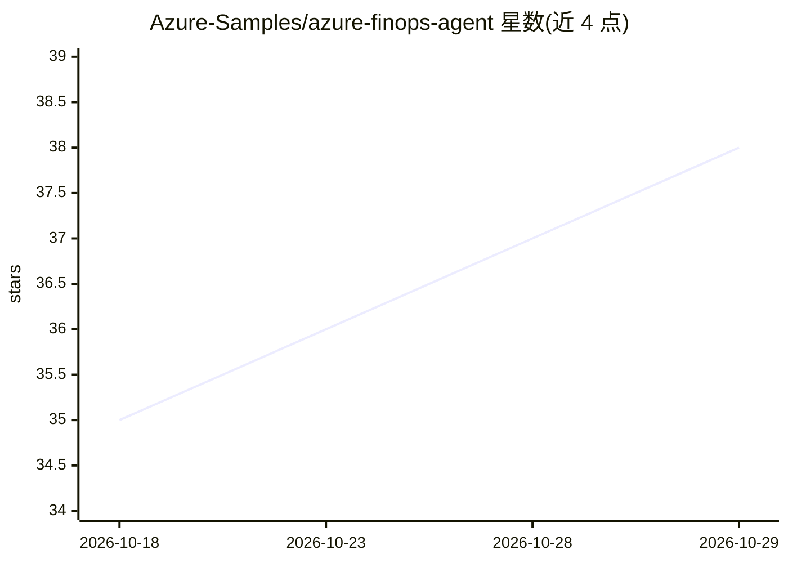

# Azure-Samples/azure-finops-agent

⭐ 38 · C# · MIT · 推送 2026-10-27 · [GitHub](https://github.com/Azure-Samples/azure-finops-agent) · [官网](https://azure-finops-agent.com/) · 组织维护

**面向 Azure 的 FinOps/InfraOps AI agent：用对话完成成本评估与治理**

开源 Azure AI 代理应用：以自然语言问答 Azure 价格、AI 成本治理与预算管控，数据来自微软文档与 Azure 实时价格；连接租户后可查询自有成本、发现节省项、输出 FinOps 成熟度评分（Crawl/Walk/Run）、生成图表、Excel 报告与 Azure CLI/PowerShell/Bicep 脚本。代理使用用户委托权限运行，代码层面阻断删除等破坏性操作；变更需在应用内显式批准。技术栈为 Vue 3 SPA + .NET 10 API，单 Linux 容器部署到 Azure App Service，模型经 Microsoft Foundry 提供。每次部署需通过 23 个真实 AI 场景评估。

## 筛选速览

| 维度 | 判定 | 备注 |
|---|---|---|
| AI 角色 | `ai-native` | 本体是模型或模型工具 |
| 许可风险 | `permissive` | MIT |
| 部署形态 | `None` |  |
| 模型依赖 | — | README 未给出锁定关系 |
| 硬件要求 | — | 无带数字的原话,不猜 |
| 安装摩擦 | `medium` | 含编译或系统依赖之一 |
| 成熟度 | — | 结构信号不足 |

## 能力要点

- 从微软文档与 Azure Retail Prices API 回答价格与治理问题，展示每次调用来源
- 连接租户后基于自有权限做成本分析、节省发现与成熟度评分
- 生成图表/Excel/HTML 演示与 Azure CLI/PowerShell/Bicep 修复脚本
- 代码级阻断删除与破坏性操作，变更需显式批准

## 适用场景

- 用对话替代多周人工评估，获得成本节省测算与成熟度评分
- 查询 Azure 各服务价格对比与三层层级应用月成本估算
- 治理 AI 代理与 AI 支出：预算、上限与审计问答
- 每日成本摘要、预算守护等计划任务

## 场景标签

`数据分析` `代码生成` · 领域:效率与自动化

## 证据(README 行号)

> L12: Azure FinOps Agent is an open-source AI agent for Azure. Ask it in plain words how to govern your AI agents, how to
> L55: - **Spend:** costs by service, subscription, resource group, tag and region, with forecasts and budgets.
> L60: - **Deliverables:** charts, Excel and CSV reports, HTML presentations, and Azure CLI, PowerShell, Bicep or ARM scri

## 星数曲线

2026-10-18 35 → 2026-10-29 38（+3）

---
*卡片 v1 · prompt 1.4 · 生成 2026-10-25 · 置信度 high · 依据 README sha `522f9fa79dab` · [字段定义](../../DATASET.md)*
