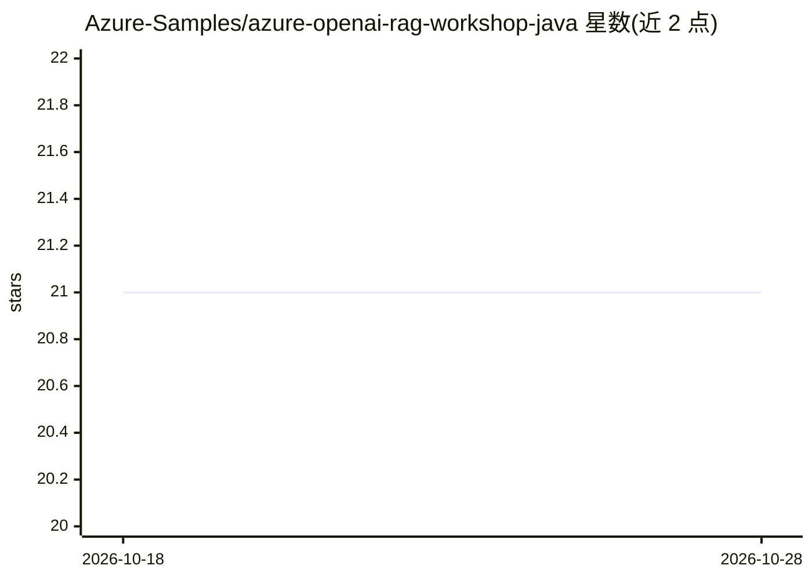

# Azure-Samples/azure-openai-rag-workshop-java

⭐ 21 · Bicep · MIT · 推送 2026-09-09 · [GitHub](https://github.com/Azure-Samples/azure-openai-rag-workshop-java) · [官网](https://aka.ms/ws/openai-rag-quarkus) · 组织维护

**Azure OpenAI 上的 Java/Quarkus RAG 聊天示例与工作坊**

微软 Azure Samples 出品的示例应用与配套工作坊：用 Quarkus 构建 Java 服务，通过 OpenAI SDK 与 LangChain4j 实现基于文档语料问答的 RAG 聊天机器人，前端网站调用 API；向量数据库使用 Qdrant，部署于 Azure Static Web Apps 与 Azure Container Apps。提供 azd 一键部署、GitHub Codespaces、Dev Containers 三种运行方式，也可按说明本地安装工具并用 Ollama + Mistral 免费本地运行。面向学习构建 AI 应用与企业数据问答的开发者，需 Azure 订阅与 Azure OpenAI 访问权限。

## 筛选速览

| 维度 | 判定 | 备注 |
|---|---|---|
| AI 角色 | `ai-ecosystem` | LLM/agent 周边工具 |
| 许可风险 | `permissive` | MIT |
| 部署形态 | `None` |  |
| 模型依赖 | local-ok | 支持本地模型 |
| 硬件要求 | — | 无带数字的原话,不猜 |
| 安装摩擦 | `low` | 无编译、无系统依赖或容器化 |
| 成熟度 | — | 结构信号不足 |

## 能力要点

- Quarkus + LangChain4j + OpenAI SDK 构建 RAG 聊天服务
- Qdrant 向量数据库，部署于 Azure Container Apps / Static Web Apps
- azd up 一键部署，支持 Codespaces 与 Dev Containers
- 可用 Ollama + Mistral 完全本地免费运行

## 适用场景

- 学习如何用 Java 生态搭建 RAG 聊天应用
- 作为企业数据问答应用的起步模板
- 在 Azure 上实践 AI 应用的部署流程

## 场景标签

`RAG` `教程课程` · 领域:知识与检索

## 证据(README 行号)

> L32: This sample shows how to build an AI chat experience with Retrieval-Augmented Generation (RAG) using LangChain4j an
> L39: This sample uses Quarkus to create a Java service that leverage OpenAI SDK and LangChain4j to build a chatbot that 

## 星数曲线

2026-10-18 21 → 2026-10-28 21（+0）

---
*卡片 v1 · prompt 1.4 · 生成 2026-10-28 · 置信度 high · 依据 README sha `6da358c09489` · [字段定义](../../DATASET.md)*
