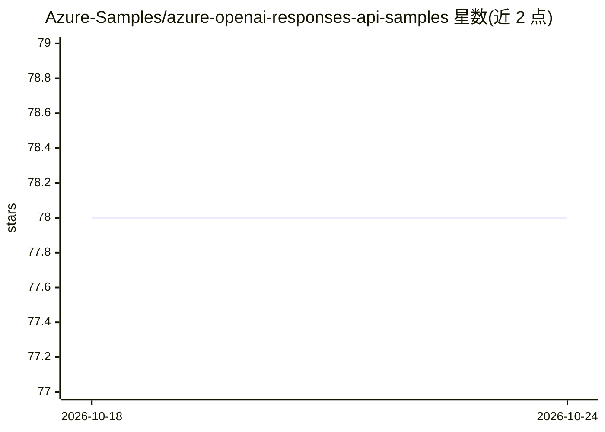

# Azure-Samples/azure-openai-responses-api-samples

⭐ 78 · Python · MIT · 推送 2026-08-19 · [GitHub](https://github.com/Azure-Samples/azure-openai-responses-api-samples) · [官网](https://aka.ms/ResponsesAPI) · 组织维护

**面向开发者的 Azure OpenAI Responses API 官方 Python 示例集**

微软 Azure-Samples 维护的代码示例库，覆盖 Azure OpenAI Responses API 的常用功能：API key 与 Entra ID 认证、流式输出、函数调用、文件搜索、Web 搜索、PDF 上传、Code Interpreter、结构化输出、推理、视觉、图像生成、MCP 远程服务器与 Batch 等。示例分 v1 GA 与旧版 API 两套，并链接 Semantic Kernel、Microsoft Agent Framework、Foundry SDK 与 Model Router 相关示例。提供 GitHub Codespaces 一键环境与 Postman/Bruno REST 集合。给在 Azure 上构建 agent 与 LLM 应用的开发者参考使用。

## 筛选速览

| 维度 | 判定 | 备注 |
|---|---|---|
| AI 角色 | `ai-ecosystem` | LLM/agent 周边工具 |
| 许可风险 | `permissive` | MIT |
| 部署形态 | `None` |  |
| 模型依赖 | locked-api |  |
| 硬件要求 | — | 无带数字的原话,不猜 |
| 安装摩擦 | `low` | 无编译、无系统依赖或容器化 |
| 成熟度 | — | 结构信号不足 |

## 能力要点

- 覆盖认证/流式/函数调用/文件搜索/MCP/结构化输出等 30 余类场景示例
- 同时提供 v1 GA 与旧版 API 两套对照示例
- 附 Postman/Bruno REST 集合与 Codespaces 快速启动环境
- 链接 Semantic Kernel、Microsoft Agent Framework、Foundry SDK 集成示例

## 适用场景

- 学习如何在 Azure OpenAI 上调用 Responses API 各项功能
- 从 Chat Completions 迁移到 Responses API 时参考对照写法
- 为 agent 应用选配函数调用、文件搜索、MCP 等工具链的起步代码

## 场景标签

`教程课程` · 领域:学习与行业

## 证据(README 行号)

> L1: # Responses API on Azure OpenAI samples
> L4: This repo includes a selection of minimal Python samples covering the most of the common features of Responses API o

## 星数曲线

2026-10-18 78 → 2026-10-24 78（+0）

---
*卡片 v1 · prompt 1.4 · 生成 2026-10-24 · 置信度 high · 依据 README sha `e10099980876` · [字段定义](../../DATASET.md)*
