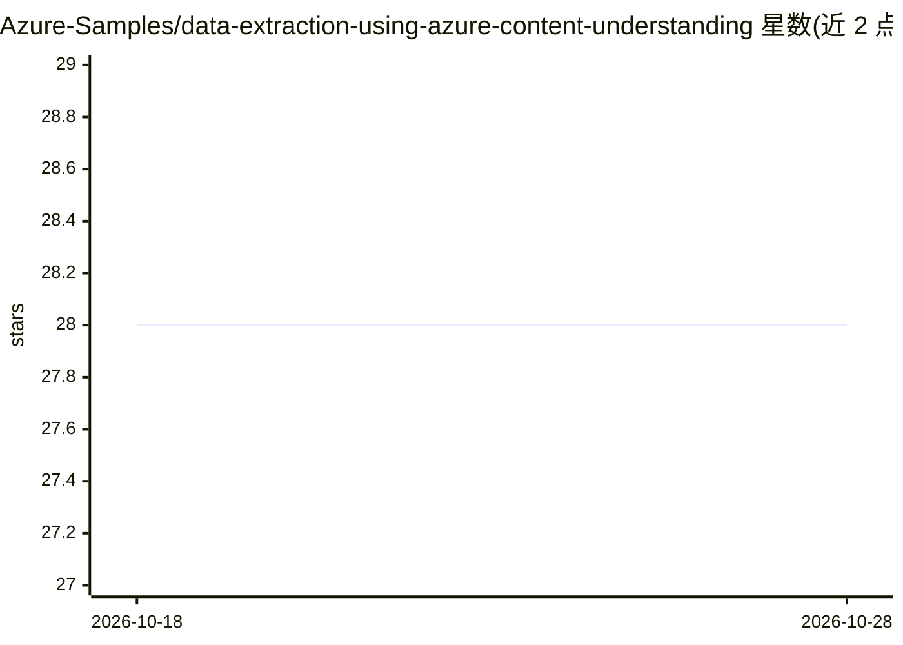

# Azure-Samples/data-extraction-using-azure-content-understanding

⭐ 28 · Python · MIT · 推送 2026-03-28 · [GitHub](https://github.com/Azure-Samples/data-extraction-using-azure-content-understanding) · 组织维护

**基于 Azure Content Understanding 的文档数据提取与自然语言查询示例方案**

Azure-Samples 官方示例项目：用 Azure Content Understanding 从文档中提取结构化数据，通过 JSON 配置定义字段 schema 与提取规则，含文档分类路由；提取结果存入 Cosmos DB，经 Azure OpenAI 提供带引用的自然语言问答。架构基于 Azure Functions 无服务器事件驱动，提供 Terraform 基础设施即代码、一键部署脚本与 Dev Container/Codespaces 环境。README 明确声明仅供演示，生产使用需补充安全、监控与错误处理。需 Azure 订阅及多项 Azure 服务访问权限。

## 筛选速览

| 维度 | 判定 | 备注 |
|---|---|---|
| AI 角色 | `ai-native` | 本体是模型或模型工具 |
| 许可风险 | `permissive` | MIT |
| 部署形态 | `library` | 以包/库形式分发 |
| 模型依赖 | locked-api |  |
| 硬件要求 | — | 无带数字的原话,不猜 |
| 安装摩擦 | `low` | 无编译、无系统依赖或容器化 |
| 成熟度 | — | 结构信号不足 |

## 能力要点

- Azure Content Understanding 提取结构化数据，JSON 定义字段 schema
- Azure OpenAI 驱动的自然语言文档问答（带引用）
- Terraform 基础设施即代码 + 一键部署脚本
- Semantic Kernel 工作流可接入 Application Insights 遥测

## 适用场景

- 在 Azure 上搭建文档数据提取与问答的参考实现
- 学习 Content Understanding + OpenAI + Functions 的集成架构
- 按自定义字段 schema 批量处理并检索业务文档

## 场景标签

`文档解析` `文档问答` · 领域:知识与检索

## 证据(README 行号)

> L7: This sample demonstrates how to build an intelligent document processing solution using Azure Content Understanding 
> L15: - **Conversational Interface**: Query processed documents using natural language powered by Azure OpenAI
> L38: 1. **Document Enquiry**: Natural language querying of processed documents using Azure OpenAI

## 星数曲线

2026-10-18 28 → 2026-10-28 28（+0）

---
*卡片 v1 · prompt 1.4 · 生成 2026-10-26 · 置信度 mid · 依据 README sha `c52b1531c577` · [字段定义](../../DATASET.md)*
