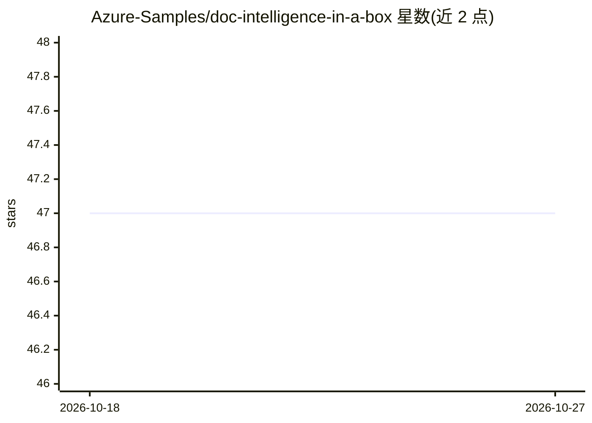

# Azure-Samples/doc-intelligence-in-a-box

⭐ 47 · Bicep · MIT · 推送 2026-03-27 · [GitHub](https://github.com/Azure-Samples/doc-intelligence-in-a-box) · [官网](https://github.com/Azure/AI-in-a-Box) · 组织维护

**Azure 方案模板：用 AI Document Intelligence 提取 PDF 表单数据**

微软 AI-in-a-Box 框架下的部署加速器：PDF 上传到 ADLS Gen2 后触发 Logic App 与 Azure Functions，调用 Azure AI Document Intelligence REST API 做表单数据提取，结构化结果存入 Azure Cosmos DB，可选接 Power BI 做报表。提供 Bicep 模块一键部署全套 Azure 资源、带标注示例数据集与自定义模型训练说明，支持替换为自己的表单与其他文件类型。面向在 Azure 订阅上构建文档处理流程的开发者与企业。

## 筛选速览

| 维度 | 判定 | 备注 |
|---|---|---|
| AI 角色 | `ai-native` | 本体是模型或模型工具 |
| 许可风险 | `permissive` | MIT |
| 部署形态 | `None` |  |
| 模型依赖 | — | README 未给出锁定关系 |
| 硬件要求 | — | 无带数字的原话,不猜 |
| 安装摩擦 | `low` | 无编译、无系统依赖或容器化 |
| 成熟度 | — | 结构信号不足 |

## 能力要点

- Bicep/azd 一键部署 Logic App + Functions + Cosmos DB 等全套 Azure 资源
- 多页 PDF 拆分为单页表单后经 REST API 提取，结果以 JSON 存 ADLS 并入 Cosmos DB
- 含标注示例数据集与自定义提取模型训练指引，可替换为自己的表单
- 可选 Power BI 语义模型与报表查看提取结果

## 适用场景

- 把发票、申请表等 PDF 表单批量提取为结构化数据入库
- 在 Azure 上快速搭建表单自动化处理的端到端方案
-  healthcare、金融等行业做表单数字化与记录管理

## 场景标签

`文档解析` · 领域:知识与检索

## 证据(README 行号)

> L50: The solution leverages Azure AI Document Intelligence to extract data from PDF forms and store the data in a Azure 
> L60:  2. Sends the location of the single page PDF file to Azure AI Document Intelligence for processing via a REST API 

## 星数曲线

2026-10-18 47 → 2026-10-27 47（+0）

---
*卡片 v1 · prompt 1.4 · 生成 2026-10-25 · 置信度 high · 依据 README sha `9f41030bbabe` · [字段定义](../../DATASET.md)*
