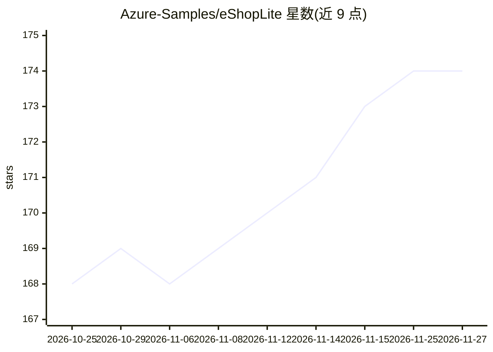

# Azure-Samples/eShopLite

⭐ 174 · C# · MIT · 推送 2026-11-21 · [GitHub](https://github.com/Azure-Samples/eShopLite) · [官网](https://aka.ms/eshoplite/repo) · 组织维护

**.NET 电商参考应用集：演示语义搜索、MCP 等场景**

由 Azure-Samples 维护的一组 .NET 参考应用，实现一个 eCommerce 站点，包含 18 个场景，覆盖关键词/语义搜索、向量数据库（内存、Azure AI Search、Chroma DB、SQL Server 2025 向量搜索）、GPT-4o Realtime Audio、DeepSeek-R1 集成、MCP 服务器与客户端、多 Agent 编排、A2A 协议等。基于 Aspire 构建，.NET 10 为基线，场景 18 使用 .NET 11 RC2 实验性 Blazor 组件。通过 azd 部署到 Azure，或用 Aspire CLI 本地运行；需要 Docker Desktop/Podman 与 Azure 模型部署。

## 筛选速览

| 维度 | 判定 | 备注 |
|---|---|---|
| AI 角色 | `ai-knowledge` | 知识聚合/清单类 |
| 许可风险 | `permissive` | MIT |
| 部署形态 | `None` |  |
| 模型依赖 | locked-api |  |
| 硬件要求 | — | 无带数字的原话,不猜 |
| 安装摩擦 | `medium` | 含编译或系统依赖之一 |
| 成熟度 | — | 结构信号不足 |

## 能力要点

- 18 个场景覆盖语义搜索、MCP、A2A、多 Agent、实时音频等
- 支持多种向量数据库实现（内存、Azure AI Search、Chroma DB、SQL Server 2025）
- 集成多种模型：GPT-4o/GPT-4.1-mini、DeepSeek-R1、GitHub Models
- Aspire CLI 本地运行与 azd 一键部署到 Azure

## 适用场景

- 学习如何在 .NET Aspire 应用中接入语义搜索与向量数据库
- 参考 MCP 服务器/客户端在电商场景中的实现方式
- 体验多 Agent 协作与 A2A 通信的编排模式
- 按 azd 模板把多服务 AI 应用部署到 Azure

## 场景标签

`多智能体` `语义搜索` `向量数据库` `RAG` · 领域:Agent 开发

## 证据(README 行号)

> L17: **eShopLite** is a set of reference .NET applications implementing an eCommerce site with features like Semantic Se
> L41: |01 - Semantic Search|A reference .NET application implementing an eCommerce site with Search features using Keywor
> L68: - .NET 10 SDK 10.0.402, pinned in the root `global.json`

## 星数曲线

2026-10-25 168 → 2026-11-27 174（+6）

---
*卡片 v1 · prompt 1.4 · 生成 2026-11-26 · 置信度 high · 依据 README sha `de3692d76ccb` · [字段定义](../../DATASET.md)*
