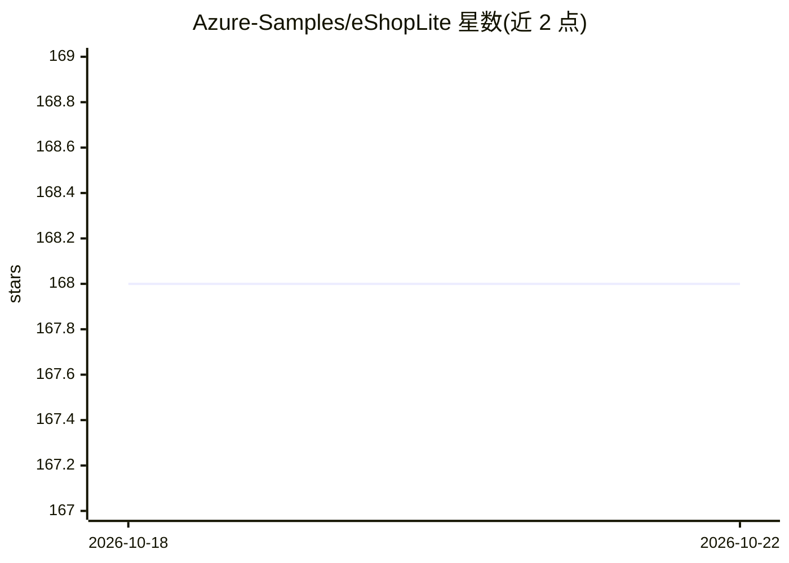

# Azure-Samples/eShopLite

⭐ 168 · C# · MIT · 推送 2026-10-14 · [GitHub](https://github.com/Azure-Samples/eShopLite) · [官网](https://aka.ms/eshoplite/repo) · 组织维护

**面向开发者的 .NET AI 电商参考应用集（18 个场景）**

Azure-Samples 维护的参考应用集合：以 .NET Aspire 构建的电商站点为载体，用 18 个独立场景演示语义搜索、MCP 服务端/客户端、推理模型（DeepSeek-R1）、向量数据库（内存/Azure AI Search/Chroma DB/SQL Server 2025）、多 Agent 编排、A2A 协议、实时音频与 Blazor Agentic UI 等 AI 集成模式。面向开发者学习与复用；提供 azd 一键部署到 Azure，本地运行需 .NET 10 SDK（场景 18 需 .NET 11 RC2）、Docker/Podman 与 Aspire CLI，Azure 模型调用可能产生费用。

## 筛选速览

| 维度 | 判定 | 备注 |
|---|---|---|
| AI 角色 | `ai-ecosystem` | LLM/agent 周边工具 |
| 许可风险 | `permissive` | MIT |
| 部署形态 | `None` |  |
| 模型依赖 | locked-api |  |
| 硬件要求 | — | 无带数字的原话,不猜 |
| 安装摩擦 | `medium` | 含编译或系统依赖之一 |
| 成熟度 | `idea` | |

## 能力要点

- 18 个场景覆盖语义搜索、MCP、多 Agent/A2A 编排、实时音频
- 集成多种模型与向量库：GPT-4o/DeepSeek-R1、Azure AI Search、Chroma DB、SQL Server 2025 向量索引
- 提供 azd 部署流程与 PowerShell 脚本统一配置 Foundry 模型和本地密钥
- 场景 18 实验性 Blazor Agentic UI（.NET 11 RC2，人工审批购物车操作）

## 适用场景

- 学习 .NET Aspire + AI 的参考架构并按场景复用代码
- 在 Azure 上一键部署带语义搜索的电商演示站
- 试验 MCP 服务端/客户端与多 Agent 协作模式

## 场景标签

`多智能体` `语义搜索` `教程课程` · 领域:Agent 开发

## 证据(README 行号)

> L17: **eShopLite** is a set of reference .NET applications implementing an eCommerce site with features like Semantic Se
> L30: - Integration with multiple AI models (GPT-4o, DeepSeek-R1, etc.)
> L33: - Model Context Protocol (MCP) server and client implementation

## 星数曲线

2026-10-18 168 → 2026-10-22 168（+0）

---
*卡片 v1 · prompt 1.4 · 生成 2026-10-22 · 置信度 high · 依据 README sha `e83982f0ed2b` · [字段定义](../../DATASET.md)*
