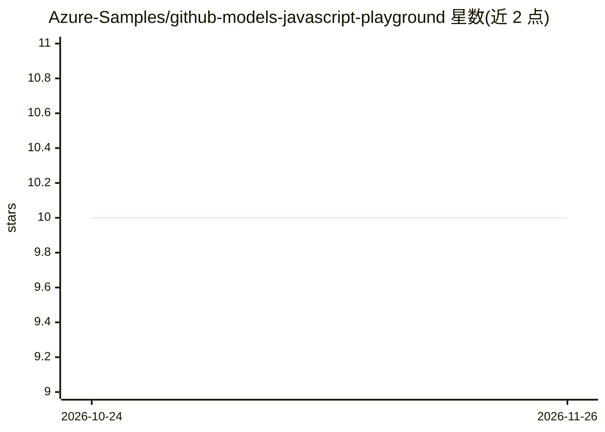

# Azure-Samples/github-models-javascript-playground

⭐ 10 · Jupyter Notebook · MIT · 推送 2026-04-09 · [GitHub](https://github.com/Azure-Samples/github-models-javascript-playground) · 组织维护

**浏览器内免费试用 GitHub Models 模型的 JavaScript 游乐场**

面向初学者的生成式 AI 游乐场项目：通过 GitHub Codespaces 提供预配置环境（内置 OpenAI Node SDK），在浏览器中直接运行 GPT-4o 等 GitHub Models 上的 LLM，无需本地安装。使用方式为打开 notebook.ipynb 交互式笔记本逐步执行，samples 目录另附基于 OpenAI Node.js SDK 的可运行示例（tsx 命令执行），并链接后续进阶教程与资源清单。

## 筛选速览

| 维度 | 判定 | 备注 |
|---|---|---|
| AI 角色 | `ai-native` | 本体是模型或模型工具 |
| 许可风险 | `permissive` | MIT |
| 部署形态 | `None` |  |
| 模型依赖 | — | README 未给出锁定关系 |
| 硬件要求 | — | 无带数字的原话,不猜 |
| 安装摩擦 | `low` | 无编译、无系统依赖或容器化 |
| 成熟度 | — | 结构信号不足 |

## 能力要点

- GitHub Codespaces 预配置环境，浏览器内运行，无需本地安装
- 内置 OpenAI Node SDK，notebook.ipynb 交互式笔记本引导
- samples 目录提供 OpenAI Node.js SDK 使用示例（tsx 运行）

## 适用场景

- 零安装地在浏览器里试用 GitHub Models 上的 LLM
- 通过交互式笔记本和示例学习 OpenAI Node.js SDK 调用
- 生成式 AI 入门学习的第一步练习环境

## 场景标签

`教程课程` · 领域:学习与行业

## 证据(README 行号)

> L14: Try out generative AI models right in your browser for free using this playground! ✨
> L16: Using GitHub Codespaces and GitHub Models, you'll be able to run LLMs (*Large Language Models)* such as Open AI GPT
> L32: In the samples folder of this repository, you'll find examples of how to use generative AI models using the OpenAI 

## 星数曲线

2026-10-24 10 → 2026-11-26 10（+0）

---
*卡片 v1 · prompt 1.4 · 生成 2026-11-20 · 置信度 high · 依据 README sha `fba03bf83f9c` · [字段定义](../../DATASET.md)*
