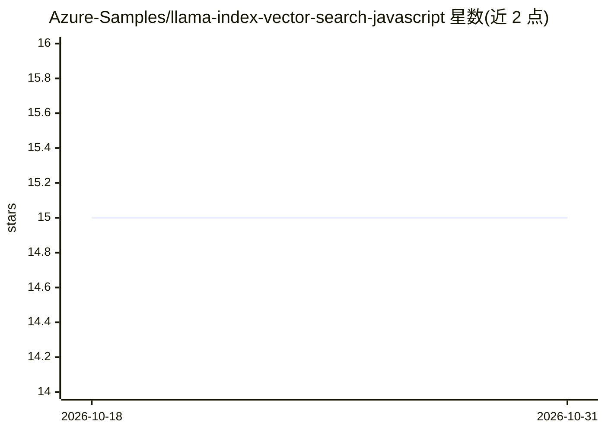

# Azure-Samples/llama-index-vector-search-javascript

⭐ 15 · TypeScript · MIT · 推送 2026-10-30 · [GitHub](https://github.com/Azure-Samples/llama-index-vector-search-javascript) · [官网](https://azure.microsoft.com/products/search) · 组织维护

**基于 Azure OpenAI 与 AI Search 的 LlamaIndex.ts RAG 聊天示例应用**

Azure-Samples 出品的 RAG 模板应用：用 LlamaIndex.ts 构建 ChatGPT 风格的代理问答界面，基于用户自有文档；GPT 模型与 embedding 经 Azure OpenAI 接入，数据索引与检索由 Azure AI Search 提供。通过 Azure Developer CLI（azd）一键预配资源并部署到 Azure Container Apps，也支持 GitHub Codespaces、Dev Containers、本地 npm 运行，以及用免费 GitHub Models 端点与免费 AI Search 零成本运行。README 明确提示该模板未含完整安全加固，不建议未经加固直接用于生产。

## 筛选速览

| 维度 | 判定 | 备注 |
|---|---|---|
| AI 角色 | `ai-native` | 本体是模型或模型工具 |
| 许可风险 | `permissive` | MIT |
| 部署形态 | `desktop` | 安装包/桌面程序 |
| 模型依赖 | locked-api |  |
| 硬件要求 | — | 无带数字的原话,不猜 |
| 安装摩擦 | `low` | 无编译、无系统依赖或容器化 |
| 成熟度 | — | 结构信号不足 |

## 能力要点

- azd 一键预配 Azure 资源并部署到 Container Apps
- npm run generate 对 ./data 文档生成 embedding 后本地运行 Next.js 开发服务器
- 支持免费 GitHub Models 端点与免费 AI Search 的零成本运行路径
- API 路由经 AUTH_MODE 控制，支持 Container Apps 内置认证

## 适用场景

- 在 Azure 上快速搭建基于自有文档的 RAG 问答应用
- 学习 LlamaIndex.ts + Azure OpenAI + AI Search 的 RAG 架构
- 以零成本方式本地试验 RAG 应用

## 场景标签

`RAG` `文档问答` · 领域:知识与检索

## 证据(README 行号)

> L3: This solution creates a ChatGPT-like, Retrieval Augmented Generation (RAG) agentic application, over your own docume
> L93: The steps below will provision Azure resources and deploy the application code to Azure Container Apps.

## 星数曲线

2026-10-18 15 → 2026-10-31 15（+0）

---
*卡片 v1 · prompt 1.4 · 生成 2026-10-31 · 置信度 mid · 依据 README sha `468dd0c3eee8` · [字段定义](../../DATASET.md)*
