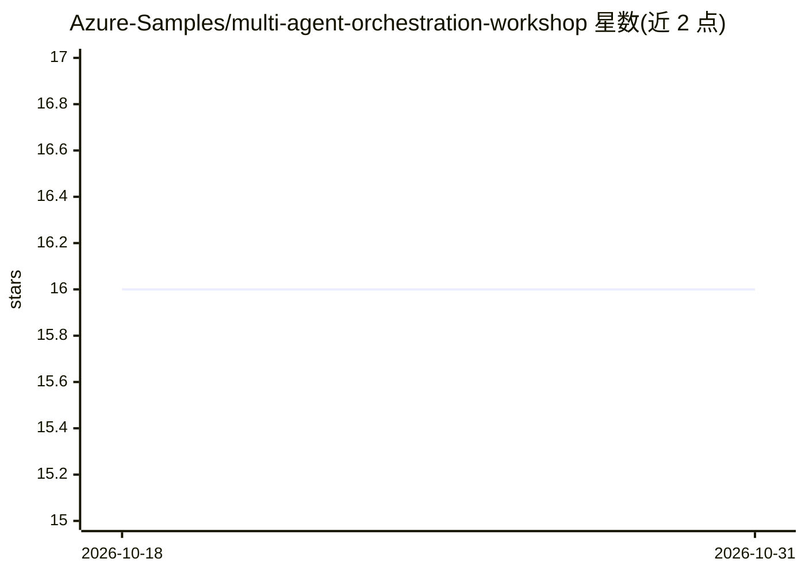

# Azure-Samples/multi-agent-orchestration-workshop

⭐ 16 · Shell · MIT · 推送 2026-07-22 · [GitHub](https://github.com/Azure-Samples/multi-agent-orchestration-workshop) · [官网](https://aka.ms/agentframework/workshop/multiagent) · 组织维护 · 中文 README

**.NET 多智能体编排模式的实操工作坊教程**

面向 .NET 开发者的多智能体编排实践工作坊，围绕 Microsoft Agent Framework、Microsoft Foundry 与 Aspire 构建。内容覆盖五种编排模式中的四种（Sequential、Concurrent、Handoff、Group Chat，Magentic 暂未包含），每个模式配文档与代码示例，最终形成 Blazor 前端 + ASP.NET 后端 + Foundry Agent Service 托管 + Aspire 编排的架构。需 Azure 订阅、.NET 10 SDK、Docker 等前置条件，提供多语言版本含中文。

## 筛选速览

| 维度 | 判定 | 备注 |
|---|---|---|
| AI 角色 | `ai-knowledge` | 知识聚合/清单类 |
| 许可风险 | `permissive` | MIT |
| 部署形态 | `None` |  |
| 模型依赖 | — | README 未给出锁定关系 |
| 硬件要求 | — | 无带数字的原话,不猜 |
| 安装摩擦 | `medium` | 含编译或系统依赖之一 |
| 成熟度 | — | 结构信号不足 |

## 能力要点

- 覆盖 Sequential/Concurrent/Handoff/Group Chat 四种编排模式
- 每模式配套文档与代码示例
- 最终架构含 Blazor 前端与 ASP.NET 后端
- README 提供含简体中文在内的 6 种语言版本

## 适用场景

- 学习 .NET 多智能体应用的编排模式实现
- 基于 Microsoft Agent Framework 搭建多智能体原型
- 了解 Blazor+Aspire+Foundry 的智能体应用架构

## 场景标签

`教程课程` `多智能体` · 领域:Agent 开发

## 证据(README 行号)

> L3: This is workshop material for building .NET-based multi-agent apps using Microsoft Agent Framework, Microsoft Foundr
> L9: Building a single-agent app is easy. But there are many real-world use cases that require multiple agents working to

## 星数曲线

2026-10-18 16 → 2026-10-31 16（+0）

---
*卡片 v1 · prompt 1.4 · 生成 2026-10-30 · 置信度 high · 依据 README sha `d931fdbaa419` · [字段定义](../../DATASET.md)*
