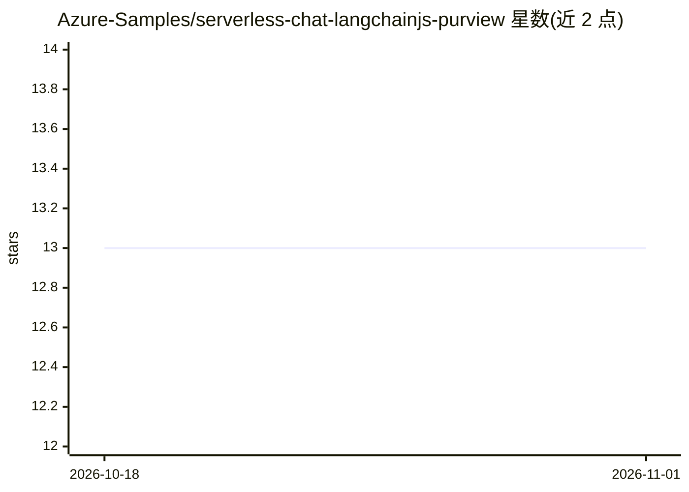

# Azure-Samples/serverless-chat-langchainjs-purview

⭐ 13 · TypeScript · MIT · 推送 2026-10-31 · [GitHub](https://github.com/Azure-Samples/serverless-chat-langchainjs-purview) · 组织维护

**示例项目：RAG 聊天应用集成 Purview API 审计与防护 AI 提示与响应**

由 fork 自 serverless-chat-langchainjs 的官方示例改造而成，展示如何在无服务器 AI 聊天应用中集成 Microsoft Purview API 以审计与防护 AI 提示与响应。应用由 Azure Static Web Apps 前端（Lit 聊天组件）、Azure Functions API（LangChain.js 做文档摄取与回答生成）、Cosmos DB for NoSQL 向量库与 Blob Storage 组成；部署前需手动完成 Entra ID 应用注册以获取 Purview Graph token 并应用 Purview 策略。支持本地用 Ollama/Llama3.1 零成本运行，或部署到 Azure 使用 Azure OpenAI。

## 筛选速览

| 维度 | 判定 | 备注 |
|---|---|---|
| AI 角色 | `ai-native` | 本体是模型或模型工具 |
| 许可风险 | `permissive` | MIT |
| 部署形态 | `desktop` | 安装包/桌面程序 |
| 模型依赖 | local-ok | 支持本地模型 |
| 硬件要求 | — | 无带数字的原话,不猜 |
| 安装摩擦 | `low` | 无编译、无系统依赖或容器化 |
| 成熟度 | — | 结构信号不足 |

## 能力要点

- Purview API 集成：审计与防护 AI 提示与响应，按策略调用相应 API
- RAG 架构：LangChain.js + Azure Functions + Cosmos DB 向量库
- 本地开发可用 Ollama + Llama3.1，无云端成本
- 提供 GitHub Codespaces 与 VS Code Dev Container 运行方式

## 适用场景

- 我想参考如何在企业聊天应用中加入 Purview 数据安全审计
- 作为基于 LangChain.js 和 Azure 无服务器架构的 RAG 应用起点
- 想零成本在本地用 Ollama 测试 RAG 聊天应用

## 场景标签

`聊天机器人` `RAG` · 领域:对话与助手

## 证据(README 行号)

> L21: This sample is originally forked from Azure-Samples/serverless-chat-langchainjs and has been modified to integrate 
> L23: This sample shows how to build a serverless AI chat experience with Retrieval-Augmented Generation using LangChain.

## 星数曲线

2026-10-18 13 → 2026-11-01 13（+0）

---
*卡片 v1 · prompt 1.4 · 生成 2026-10-31 · 置信度 mid · 依据 README sha `1109c7c0afe6` · [字段定义](../../DATASET.md)*
