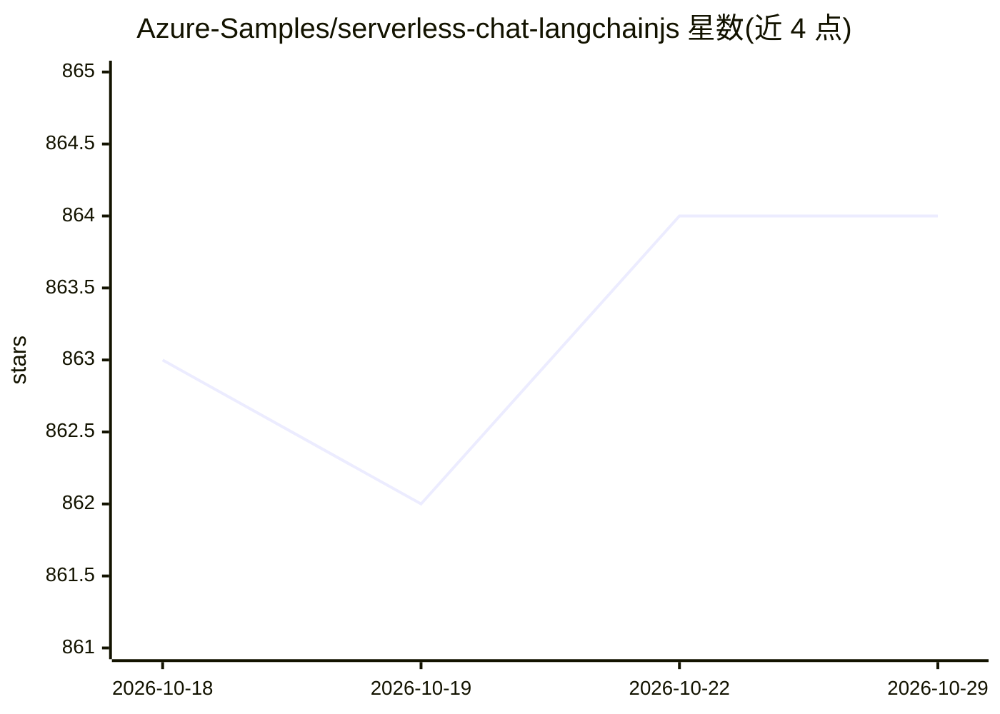

# Azure-Samples/serverless-chat-langchainjs

⭐ 864 · TypeScript · MIT · 推送 2026-10-28 · [GitHub](https://github.com/Azure-Samples/serverless-chat-langchainjs) · 组织维护

**Azure 官方的 Serverless RAG 聊天应用示例模板**

由 Azure-Samples 维护的示例项目：演示如何用 LangChain.js、TypeScript 与 Azure 服务构建带 RAG 的无服务器 AI 聊天应用。架构含 Lit 构建的 Web 组件（Azure Static Web Apps 托管）、Azure Functions 无服务器 API（负责文档摄取与回答生成）、Azure Cosmos DB for NoSQL 作为向量库与 Azure Blob Storage 存储文档。附带虚构公司 Contoso Real Estate 的示例数据；支持部署到 Azure，或用 Ollama（llama3.1 + nomic-embed-text）完全本地运行，无需云资源费用。本地运行限制：小模型对引用与追问格式的遵循可能不完整。

## 筛选速览

| 维度 | 判定 | 备注 |
|---|---|---|
| AI 角色 | `ai-ecosystem` | LLM/agent 周边工具 |
| 许可风险 | `permissive` | MIT |
| 部署形态 | `desktop` | 安装包/桌面程序 |
| 模型依赖 | local-ok | 支持本地模型 |
| 硬件要求 | — | 无带数字的原话,不猜 |
| 安装摩擦 | `low` | 无编译、无系统依赖或容器化 |
| 成熟度 | — | 结构信号不足 |

## 能力要点

- Azure Functions + Static Web Apps + Cosmos DB 的无服务器架构
- 支持 Ollama（llama3.1/nomic-embed-text）完全本地运行
- azd up 一键部署并自动构建搜索索引
- 提供 GitHub Codespaces / VS Code Dev Container 预配置环境

## 适用场景

- 以此模板为起点构建企业文档问答应用
- 学习 LangChain.js + Azure 的 RAG 实现方式
- 本地用 Ollama 零成本测试 RAG 聊天应用

## 场景标签

`RAG` `文档问答` · 领域:知识与检索

## 证据(README 行号)

> L21: This sample shows how to build a serverless AI chat experience with Retrieval-Augmented Generation using LangChain.
> L28: Building AI applications can be complex and time-consuming, but using LangChain.js and Azure serverless technologie

## 星数曲线

2026-10-18 863 → 2026-10-29 864（+1）

---
*卡片 v1 · prompt 1.4 · 生成 2026-10-21 · 置信度 high · 依据 README sha `c0ab9c73c24c` · [字段定义](../../DATASET.md)*
