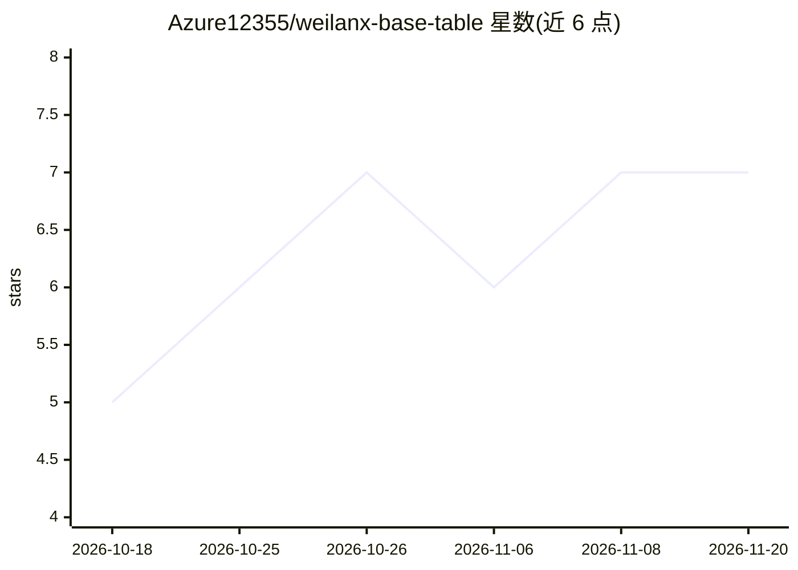

# Azure12355/weilanx-base-table

⭐ — · [GitHub]() · 个人维护 · 中文 README

**在 VS Code/Obsidian 中把 .wbase JSON 文件当多维表格编辑**

VS Code 扩展与 Obsidian 插件，将单个 .wbase（纯 JSON）文件以多维表格形式打开：支持多视图、AND/OR 多条件过滤（16 种操作符）、排序、按字段折叠分组、8 种字段类型、行内编辑、TSV/HTML 复制、CSV/Excel/JSON 导出。同一文件可在 VS Code 与 Obsidian（含移动端）间共享，外部编辑实时刷新；文件格式带稳定 record id，面向 AI agent 读写，安装可交给编码 agent 按 docs 完成。

## 筛选速览

| 维度 | 判定 | 备注 |
|---|---|---|
| AI 角色 | `ai-enhanced` | 去掉 AI 部分产品仍成立 |
| 许可风险 | `permissive` | — |
| 部署形态 | `library` | 以包/库形式分发 |
| 模型依赖 | — | README 未给出锁定关系 |
| 硬件要求 | — | 无带数字的原话,不猜 |
| 安装摩擦 | `low` | 无编译、无系统依赖或容器化 |
| 成熟度 | — | 结构信号不足 |

## 能力要点

- .wbase 文件为纯 JSON，每条记录带稳定 id，可用 JSON.parse 直接读取
- 多视图/过滤（16 操作符）/排序/分组/冻结列等表格功能
- VS Code 与 Obsidian 共用同一文件格式，支持旧 .base 转换
- 提供 macOS/Linux 安装脚本与面向 agent 的安装文档

## 适用场景

- 在 VS Code 中管理选题库、清单类数据
- 在 Obsidian 桌面与移动端编辑结构化表格并与笔记互链
- 让编码 agent 直接读写表格数据文件

## 场景标签

 · 领域:开发者工具/数据表格

## 证据(README 行号)

> L26: Weilanx Base Table turns a single `.wbase` file into a **multidimensional table** (think Airtable / Feishu Base) wi
> L82: - 🤖 Single-file JSON with a stable `id` per record — trivial for AI agents to read and write
> L85: # 🤖 Install with an AI Agent

## 星数曲线

2026-10-18 5 → 2026-11-20 7（+2）

---
*卡片 v1 · prompt 1.4 · 生成 2026-11-20 · 置信度 high · 依据 README sha `67d8b66eafe9` · [字段定义](../../DATASET.md)*
