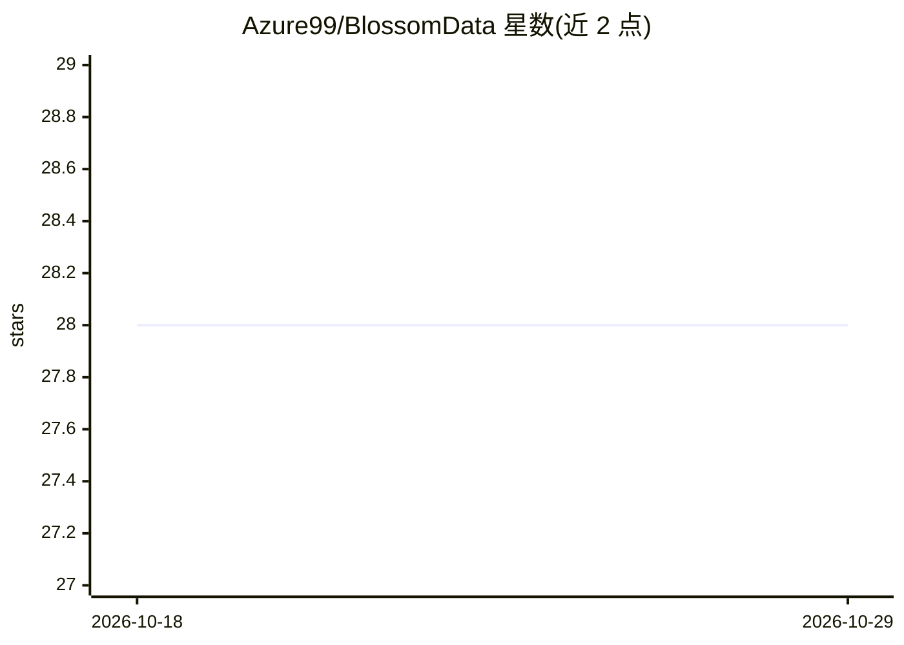

# Azure99/BlossomData

⭐ 28 · Python · MIT · 推送 2026-01-31 · [GitHub](https://github.com/Azure99/BlossomData) · 个人维护 · 中文 README

**面向大模型训练的数据处理与合成框架，支持单机到分布式**

专为大模型训练打造的数据处理框架：提供内置算子库（Map/Filter/Transform 三类），支持不同模态、不同训练阶段的数据处理与合成，例如基于数学题与参考答案合成经一致性校验的长推理中文训练数据。同一套代码可运行于 Local、Multiprocess、Spark、Ray 多种执行引擎，从单机无缝迁移到分布式；用户可扩展自定义算子与 DataHandler。使用前需在 config.yaml 配置模型服务提供商的 API 密钥，以 pip 包形式提供。面向需要构建 LLM 训练数据管道的开发者。

## 筛选速览

| 维度 | 判定 | 备注 |
|---|---|---|
| AI 角色 | `ai-ecosystem` | LLM/agent 周边工具 |
| 许可风险 | `permissive` | MIT |
| 部署形态 | `library` | 以包/库形式分发 |
| 模型依赖 | — | README 未给出锁定关系 |
| 硬件要求 | — | 无带数字的原话,不猜 |
| 安装摩擦 | `low` | 无编译、无系统依赖或容器化 |
| 成熟度 | — | 结构信号不足 |

## 能力要点

- 内置算子库含 LLM 调用类算子（如 ChatDistiller 生成回答、ChatReasoningConsistencyFilter 一致性校验过滤）
- 同一套代码支持 Local/Multiprocess/Spark/Ray 四种执行引擎
- 强类型 Schema 体系与自定义 DataHandler 加载保存
- 示例：仅凭数学题与参考答案合成经验证的长推理中文训练数据

## 适用场景

- 为 LLM 微调构建数据处理与合成管道
- 用 LLM 生成回答并做一致性校验过滤不可靠样本
- 从单机数据处理平滑扩展到 Spark/Ray 分布式环境

## 场景标签

`MLOps` · 领域:训练与推理

## 证据(README 行号)

> L9: BlossomData是一个专为大模型训练打造的数据处理框架，旨在提供灵活、高效的数据处理解决方案。它内置丰富的算子库，支持不同模态、不同训练阶段的数据处理与合成。能够从单机环境无缝迁移到分布式环境，允许用户灵活扩展自定义算子，从而
> L30: 框架提供了大量内置算子，可以在blossom.op中查看。例如，当原始数据缺失答案时，可以使用ChatDistiller生成回答，然后通过ChatReasoningConsistencyFilter基于LLM一致性校验过滤掉潜在不
> L62: DataFrame是对数据的抽象表示，提供了对数据进行转换、过滤和聚合的接口。框架支持多种DataFrame实现，包括Local、Multiprocess、Spark和Ray，使得同一套代码可以在不同的执行引擎中运行。

## 星数曲线

2026-10-18 28 → 2026-10-29 28（+0）

---
*卡片 v1 · prompt 1.4 · 生成 2026-10-26 · 置信度 high · 依据 README sha `08c2595751e7` · [字段定义](../../DATASET.md)*
