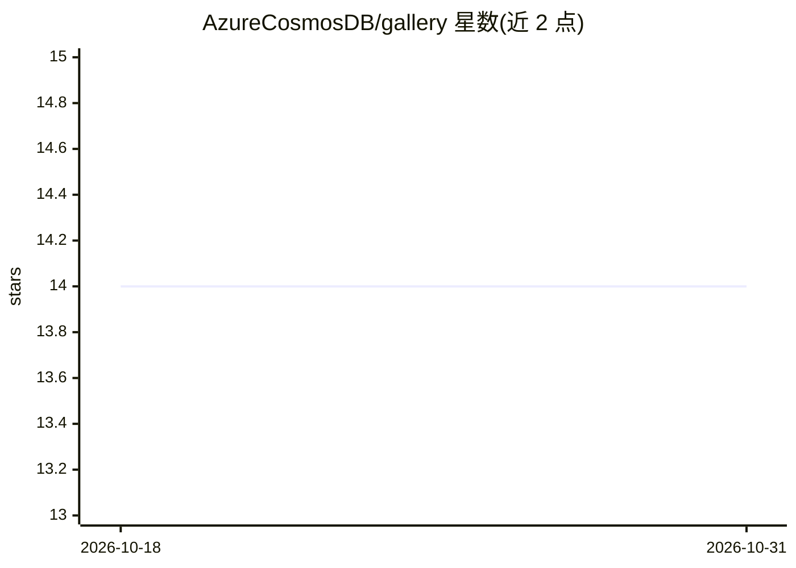

# AzureCosmosDB/gallery

⭐ 14 · JavaScript · MIT · 推送 2026-10-01 · [GitHub](https://github.com/AzureCosmosDB/gallery) · [官网](https://azurecosmosdb.github.io/gallery/) · 组织维护

**Azure Cosmos DB 资源聚合站点：代码示例、文档、视频、模板**

Azure Cosmos DB 官方维护的资源画廊网站（Docusaurus 构建，发布于 GitHub Pages），收录 Python/JavaScript/C# 代码示例、文档文章、视频博客、数据迁移工具等资源，社区可贡献。维护机制上由每周自动化工作流审计条目、发现新内容并生成提案 issue，由指定 agent 创建草案 PR 供人工审核，不自动合并。安装方式为 npm ci 后本地运行或构建静态站点。

## 筛选速览

| 维度 | 判定 | 备注 |
|---|---|---|
| AI 角色 | `ai-knowledge` | 知识聚合/清单类 |
| 许可风险 | `permissive` | MIT |
| 部署形态 | `None` |  |
| 模型依赖 | — | README 未给出锁定关系 |
| 硬件要求 | — | 无带数字的原话,不猜 |
| 安装摩擦 | `low` | 无编译、无系统依赖或容器化 |
| 成熟度 | — | 结构信号不足 |

## 能力要点

- 聚合代码示例、文档、视频、迁移工具等 Cosmos DB 资源
- 每周自动化维护工作流（agent 草案 PR + 人工审核）
- 基于 Docusaurus 2 构建并经 GitHub Pages 部署

## 适用场景

- 查找 Azure Cosmos DB 的多语言代码示例与文档
- 为 Cosmos DB 项目寻找数据迁移工具
- 社区贡献自己的 Cosmos DB 教程或示例

## 场景标签

`精选清单` · 领域:学习与行业

## 证据(README 行号)

> L3: This repository is your one-stop shop for Azure Cosmos DB resources, including:
> L5: - GitHub Samples: Code in Python, JavaScript, and C#

## 星数曲线

2026-10-18 14 → 2026-10-31 14（+0）

---
*卡片 v1 · prompt 1.4 · 生成 2026-10-31 · 置信度 high · 依据 README sha `cccb07ec9e34` · [字段定义](../../DATASET.md)*
