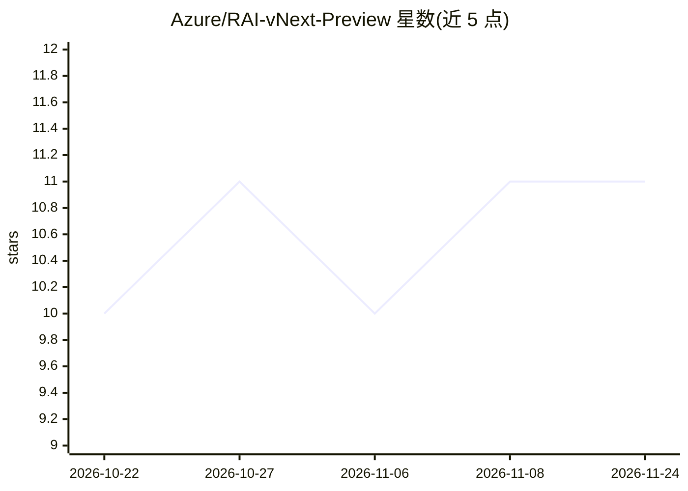

# Azure/RAI-vNext-Preview

⭐ 11 · Python · MIT · 推送 2026-11-11 · [GitHub](https://github.com/Azure/RAI-vNext-Preview) · 组织维护

**面向 AzureML 用户的负责任 AI 仪表板公开预览与接入工具**

Azure Machine Learning 负责任 AI 仪表板的公开预览仓库，通过 SDK v2/CLI v2 在 AzureML 工作区生成模型洞察：错误分析、数据探索、模型统计、可解释性（InterpretML）、反事实分析（DiCE）与因果分析（EconML），结果可在 AzureML studio 或 Jupyter notebook 中查看。支持实现 predict/predict_proba 的 scikit-learn 模型与 pandas DataFrame 输入；初版不支持公平性指标集成，模型须以 MLflow sklearn 格式注册、可 pickle，数据集须为 Parquet 格式 DataFrame。

## 筛选速览

| 维度 | 判定 | 备注 |
|---|---|---|
| AI 角色 | `ai-native` | 本体是模型或模型工具 |
| 许可风险 | `permissive` | MIT |
| 部署形态 | `None` |  |
| 模型依赖 | — | README 未给出锁定关系 |
| 硬件要求 | — | 无带数字的原话,不猜 |
| 安装摩擦 | `low` | 无编译、无系统依赖或容器化 |
| 成熟度 | `idea` | |

## 能力要点

- 集成错误分析、可解释性、反事实与因果分析四类洞察
- 提供 Python SDK 与 CLI 两种生成方式及 setup 脚本
- 按 cohort 过滤查看仪表板洞察，支持交互式生成反事实与因果 what-if
- 提供模型调试与决策示例 notebook 及 CLI 示例目录

## 适用场景

- 诊断模型在特定数据群体上的高错误率 cohort
- 解释黑盒模型的全局行为与个体预测原因
- 通过反事实与因果分析做数据驱动的 what-if 决策

## 场景标签

`模型评测` · 领域:评测与运维

## 证据(README 行号)

> L9: AzureML currently supports both model explanations and model fairness in public preview. As we expand our offerings 
> L29: The AzureML components in this repo support computation of Responsible AI insights for `scikit-learn` models that a
> L42: This is all available via Python SDK or CLI.

## 星数曲线

2026-10-22 10 → 2026-11-24 11（+1）

---
*卡片 v1 · prompt 1.4 · 生成 2026-11-19 · 置信度 high · 依据 README sha `92527d9ca9fc` · [字段定义](../../DATASET.md)*
