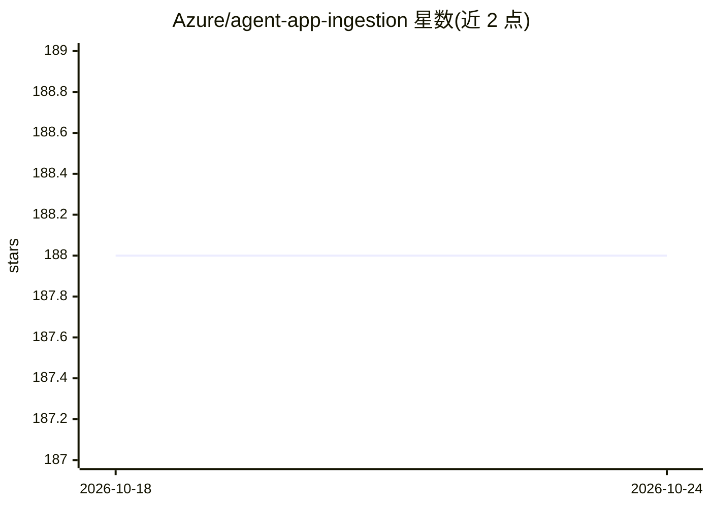

# Azure/agent-app-ingestion

⭐ 188 · Python · MIT · 推送 2026-10-23 · [GitHub](https://github.com/Azure/agent-app-ingestion) · [官网](https://aka.ms/agentlz) · 组织维护

**Agent Landing Zone 的数据摄取服务：把文档转为 agent 检索知识**

Python 3.12 编写的摄取服务，面向 Agent Landing Zone 平台：读取 PDF、图片、电子表格、转录与 SharePoint 内容，进行分块、生成嵌入并写入 Azure AI Search，同时运行 Blob、SharePoint、NL2SQL 与维护任务，暴露摄取 API 与运维面板。服务本身不执行对话 agent，也不存储完整聊天历史。本地运行需先具备 Agent Landing Zone 基础设施与 App Configuration 存储，仓库的 Bicep 文件不能独立部署环境；启动任务默认开启，可能写入或删除数据。

## 筛选速览

| 维度 | 判定 | 备注 |
|---|---|---|
| AI 角色 | `ai-ecosystem` | LLM/agent 周边工具 |
| 许可风险 | `permissive` | MIT |
| 部署形态 | `library` | 以包/库形式分发 |
| 模型依赖 | — | README 未给出锁定关系 |
| 硬件要求 | — | 无带数字的原话,不猜 |
| 安装摩擦 | `low` | 无编译、无系统依赖或容器化 |
| 成熟度 | — | 结构信号不足 |

## 能力要点

- 多源摄取：Blob、SharePoint、电子表格、转录与 NL2SQL 任务
- 分块、生成嵌入并写入 Azure AI Search 供 agent 检索
- 提供摄取 API、运维面板与单独门控的托管检索 API
- GET /healthz 与 /readyz 为进程探针，不代表索引完成

## 适用场景

- 为企业 agent 平台批量把文档转为可检索的 grounding 知识
- 从 SharePoint 与 Blob 持续摄取内容并维护 Azure AI Search 索引
- 运维人员通过面板与调度任务监控摄取流程

## 场景标签

`RAG` · 领域:知识与检索

## 证据(README 行号)

> L4: Agent Landing Zone. It chunks
> L6: Blob, SharePoint, NL2SQL, and maintenance jobs. It also exposes ingestion APIs,
> L31: through Agent Landing Zone first. This repository's Bicep file does not

## 星数曲线

2026-10-18 188 → 2026-10-24 188（+0）

---
*卡片 v1 · prompt 1.4 · 生成 2026-10-22 · 置信度 mid · 依据 README sha `18575a34fdff` · [字段定义](../../DATASET.md)*
