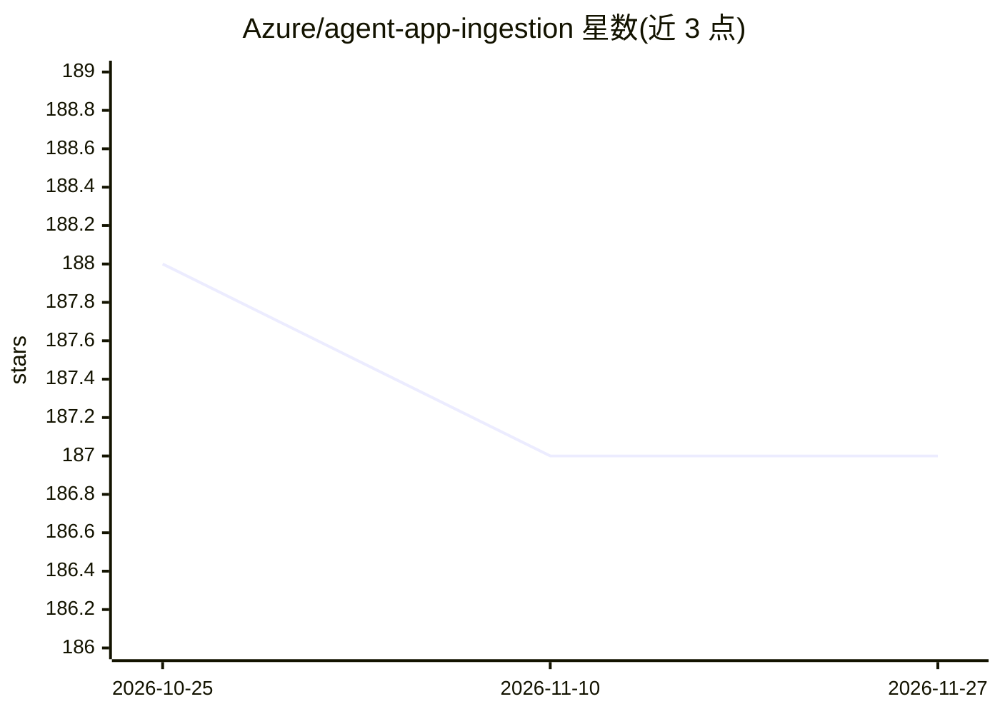

# Azure/agent-app-ingestion

⭐ 187 · Python · MIT · 推送 2026-11-26 · [GitHub](https://github.com/Azure/agent-app-ingestion) · [官网](https://aka.ms/agentlz) · 组织维护

**为 Agent Landing Zone 生成 RAG 知识的文档摄取服务**

Python 3.12 编写的摄取服务，属于 Agent Landing Zone 体系：对文档分块、生成多模态嵌入、写入 Azure AI Search，并运行 Blob、SharePoint、NL2SQL 与维护任务。同时提供摄取 API、运维仪表盘以及单独鉴权的托管检索 API。定位是处理文档而非会话型 agent；面向需要为 agent 构建接地知识库的企业/开发团队，文档集中在 Azure/AI-Landing-Zones 仓库发布。

## 筛选速览

| 维度 | 判定 | 备注 |
|---|---|---|
| AI 角色 | `ai-ecosystem` | LLM/agent 周边工具 |
| 许可风险 | `permissive` | MIT |
| 部署形态 | `None` |  |
| 模型依赖 | — | README 未给出锁定关系 |
| 硬件要求 | — | 无带数字的原话,不猜 |
| 安装摩擦 | `low` | 无编译、无系统依赖或容器化 |
| 成熟度 | — | 结构信号不足 |

## 能力要点

- 文档分块 + 多模态嵌入 + 写入 Azure AI Search
- 支持 Blob、SharePoint、NL2SQL 与维护任务
- 提供摄取 API 与运维仪表盘
- 检索 API 为单独鉴权的托管服务

## 适用场景

- 为 agent 摄取 PDF/图片/表格/转写稿等文档形成知识库
- 接入 SharePoint 内容做组织级 RAG 数据源
- 运维团队通过仪表盘管理摄取任务与恢复

## 场景标签

`RAG` `文档解析` · 领域:知识与检索

## 证据(README 行号)

> L3: The Python 3.12 ingestion service for
> L5: documents, generates embeddings, writes Azure AI Search content, and runs
> L8: It processes documents, not conversational agents.

## 星数曲线

2026-10-25 188 → 2026-11-27 187（-1）

---
*卡片 v1 · prompt 1.4 · 生成 2026-11-27 · 置信度 high · 依据 README sha `a7c7fa84faf2` · [字段定义](../../DATASET.md)*
