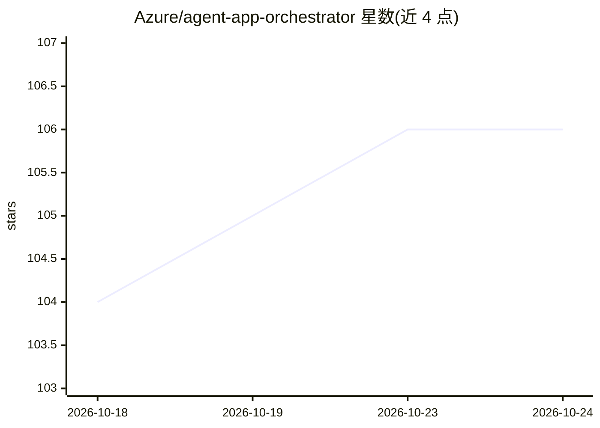

# Azure/agent-app-orchestrator

⭐ 106 · Python · MIT · 推送 2026-10-20 · [GitHub](https://github.com/Azure/agent-app-orchestrator) · [官网](https://aka.ms/agentlz) · 组织维护

**Agent Landing Zone 的多智能体编排服务（Python/FastAPI）**

面向 Azure Agent Landing Zone 的会话式智能体执行编排服务：选择已配置的执行策略，流式返回回答，并整合模型、检索与工具（含 agentic RAG、NL2SQL、MCP）。经典模式基于 FastAPI 与 Cosmos DB 存储会话，另有基于 Microsoft Foundry 的无状态托管入口。本仓库不独立供给 Azure 资源，需先通过 Agent Landing Zone 配置基础设施、App Configuration 与 RBAC 后本地运行；SQL 策略需额外 ODBC 依赖。

## 筛选速览

| 维度 | 判定 | 备注 |
|---|---|---|
| AI 角色 | `ai-ecosystem` | LLM/agent 周边工具 |
| 许可风险 | `permissive` | MIT |
| 部署形态 | `self-host` | docker 或自建部署 |
| 模型依赖 | — | README 未给出锁定关系 |
| 硬件要求 | — | 无带数字的原话,不猜 |
| 安装摩擦 | `low` | 无编译、无系统依赖或容器化 |
| 成熟度 | — | 结构信号不足 |

## 能力要点

- 策略选择式的多智能体编排，流式回答输出
- 整合模型、检索（默认 Azure AI Search 后端）与 MCP 工具
- 经典模式用 FastAPI + Cosmos DB 存储会话，Foundry 托管入口无状态
- 版本与 Agent Landing Zone 4.3.0 锁定（v5.2.1）

## 适用场景

- 在 Agent Landing Zone 部署中承担智能体编排与对话执行
- 为 Grounded RAG 与 NL2SQL 场景协调专项智能体
- 本地开发调试编排服务（Python 3.12 + Azure CLI）

## 场景标签

`Agent 框架` `多智能体` `RAG` · 领域:Agent 开发

## 证据(README 行号)

> L4: Agent Landing Zone. It selects a
> L5: configured strategy, streams answers, and integrates models, retrieval, and
> L6: tools. Classic execution uses FastAPI and Cosmos DB conversation storage.

## 星数曲线

2026-10-18 104 → 2026-10-24 106（+2）

---
*卡片 v1 · prompt 1.4 · 生成 2026-10-23 · 置信度 mid · 依据 README sha `7287f690947e` · [字段定义](../../DATASET.md)*
