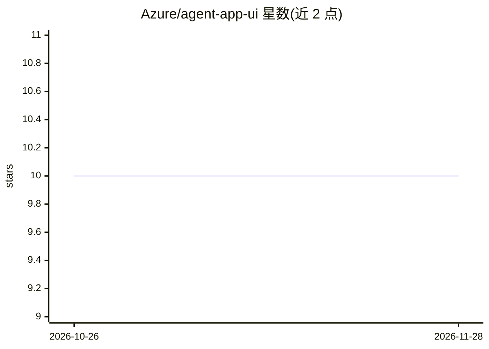

# Azure/agent-app-ui

⭐ 10 · Python · MIT · 推送 2026-11-27 · [GitHub](https://github.com/Azure/agent-app-ui) · [官网](https://aka.ms/agentlz) · 组织维护

**Agent Landing Zone 的 Chainlit 会话界面，流式展示代理响应与引用**

Agent Landing Zone 的 Web 客户端，基于 Chainlit 构建：流式显示代理响应、展示引用出处并收集用户反馈；支持自定义与主题化，可将聊天嵌入现有门户。README 未包含安装命令，用户/运维/开发者手册统一托管在 Azure/AI-Landing-Zones 仓库的 docs/agent-landing-zone 目录；该组件本身不负责平台配置（provisioning）。

## 筛选速览

| 维度 | 判定 | 备注 |
|---|---|---|
| AI 角色 | `ai-ecosystem` | LLM/agent 周边工具 |
| 许可风险 | `permissive` | MIT |
| 部署形态 | `None` |  |
| 模型依赖 | — | README 未给出锁定关系 |
| 硬件要求 | — | 无带数字的原话,不猜 |
| 安装摩擦 | `low` | 无编译、无系统依赖或容器化 |
| 成熟度 | — | 结构信号不足 |

## 能力要点

- 基于 Chainlit 流式展示代理响应与引用
- 收集用户反馈
- 支持自定义与主题化，聊天可嵌入门户
- 本地运行指南托管于 AI-Landing-Zones 中央文档站

## 适用场景

- 为 Agent Landing Zone 提供对话式前端
- 在门户中嵌入代理聊天界面
- 查看代理回答的引用出处并反馈质量

## 场景标签

`聊天机器人` · 领域:对话与助手

## 证据(README 行号)

> L3: The Agent Landing Zone web client
> L4: uses Chainlit to stream agent responses, display
> L20: This component does not provision the platform.

## 星数曲线

2026-10-26 10 → 2026-11-28 10（+0）

---
*卡片 v1 · prompt 1.4 · 生成 2026-11-20 · 置信度 mid · 依据 README sha `c2242e004a24` · [字段定义](../../DATASET.md)*
