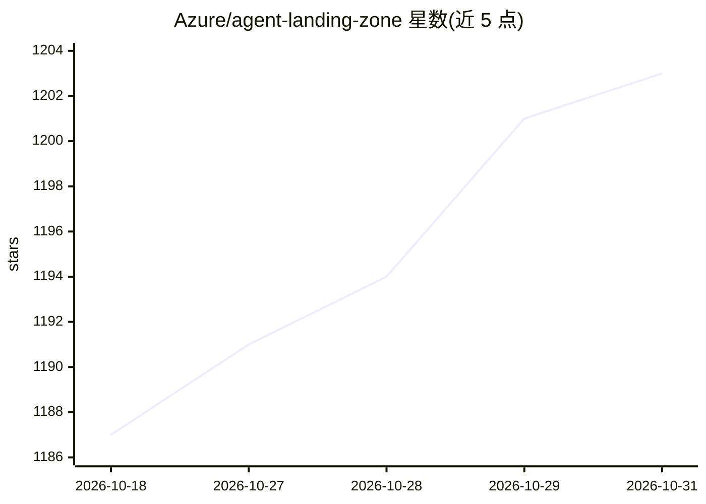

# Azure/agent-landing-zone

⭐ 1,203 · Python · MIT · 推送 2026-10-30 · [GitHub](https://github.com/Azure/agent-landing-zone) · [官网](https://aka.ms/agentlz) · 组织维护

**Azure 上部署企业 AI agent 应用的安全落地区模板**

微软维护的企业级 landing zone 项目（前身为 GPT-RAG），用于在 Azure 上部署 AI agent 应用所需的安全基础设施与默认 agent 应用，基于 Microsoft Foundry 与 Microsoft Agent Framework 构建，包含 Zero Trust 网络架构、可观测性与基础设施即代码。支持三种部署模式：全栈、仅基础设施、部署自定义应用。组件版本在 manifest.json 中固定，UI/Orchestrator/Ingestion 等组件来自独立仓库。MIT 许可。

## 筛选速览

| 维度 | 判定 | 备注 |
|---|---|---|
| AI 角色 | `ai-ecosystem` | LLM/agent 周边工具 |
| 许可风险 | `permissive` | MIT |
| 部署形态 | `None` |  |
| 模型依赖 | — | README 未给出锁定关系 |
| 硬件要求 | — | 无带数字的原话,不猜 |
| 安装摩擦 | `low` | 无编译、无系统依赖或容器化 |
| 成熟度 | — | 结构信号不足 |

## 能力要点

- 支持全栈、仅基础设施、自定义应用三种部署模式
- 基于 Microsoft Foundry 与 Microsoft Agent Framework，含 Zero Trust 架构
- 组件版本在 manifest.json 中固定
- 前身为 GPT-RAG 项目，同一项目更名扩展

## 适用场景

- 企业在 Azure 上快速部署符合 Zero Trust 的 agent 应用基础设施
- 在既有落地区之上部署自己的 agent 应用
- 参考企业级 agent 应用的参考架构与 IaC 实现

## 场景标签

`RAG` · 领域:知识与检索

## 证据(README 行号)

> L5: Secure, enterprise-ready landing zone for deploying AI agent applications on Microsoft Foundry.
> L12: > **GPT-RAG has evolved into Agent Landing Zone.** Same project, new name and broader scope: infrastructure and app

## 星数曲线

2026-10-18 1,187 → 2026-10-31 1,203（+16）

---
*卡片 v1 · prompt 1.4 · 生成 2026-10-21 · 置信度 high · 依据 README sha `027b20512664` · [字段定义](../../DATASET.md)*
