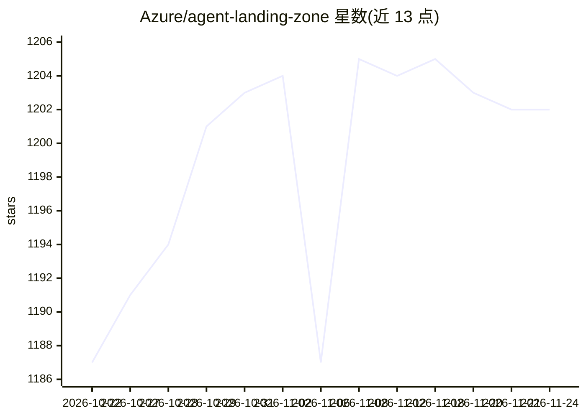

# Azure/agent-landing-zone

⭐ 1,202 · Python · MIT · 推送 2026-11-21 · [GitHub](https://github.com/Azure/agent-landing-zone) · [官网](https://aka.ms/agentlz) · 组织维护

**面向企业的 AI Agent 应用 Azure 落地基础架构模板**

基于 Microsoft Foundry 与 Microsoft Agent Framework 的 Azure 落地基础架构项目，前身是 GPT-RAG，项目范围扩展为企业级 Agent 的基础设施与应用。提供三种部署路径：全栈（基础设施+默认 Agent 应用）、仅基础设施、在基础之上部署自定义应用。内置 Zero-Trust 私有网络参考架构，组件版本通过 manifest.json 固定，UI、编排器、可选的数据摄取与 MCP 服务器等组件来自独立的 Azure 仓库。通过 Azure Developer CLI 部署，使用 Bicep 实现 IaC。

## 筛选速览

| 维度 | 判定 | 备注 |
|---|---|---|
| AI 角色 | `ai-ecosystem` | LLM/agent 周边工具 |
| 许可风险 | `permissive` | MIT |
| 部署形态 | `None` |  |
| 模型依赖 | — | README 未给出锁定关系 |
| 硬件要求 | — | 无带数字的原话,不猜 |
| 安装摩擦 | `low` | 无编译、无系统依赖或容器化 |
| 成熟度 | — | 结构信号不足 |

## 能力要点

- 提供全栈/仅基础设施/自定义应用三种部署路径
- Zero-Trust 私有网络参考架构
- 组件版本固定于 manifest.json，UI/编排器/摄取/MCP 服务器分仓维护
- 基于 Microsoft Foundry 与 Microsoft Agent Framework 构建

## 适用场景

- 在 Azure 上以私有网络方式部署企业 Agent 应用
- 为自研 Agent 应用搭建安全的基础设施底座
- 从 GPT-RAG 旧部署迁移到新架构

## 场景标签

`RAG` · 领域:知识与检索

## 证据(README 行号)

> L5: Secure, enterprise-ready landing zone for deploying AI agent applications on Microsoft Foundry.
> L25: - Full stack — Deploy the infrastructure and default agent application.
> L26: - Infrastructure only — Provision the foundation without deploying application images.

## 星数曲线

2026-10-22 1,187 → 2026-11-24 1,202（+15）

---
*卡片 v1 · prompt 1.4 · 生成 2026-11-23 · 置信度 high · 依据 README sha `3700335957c9` · [字段定义](../../DATASET.md)*
