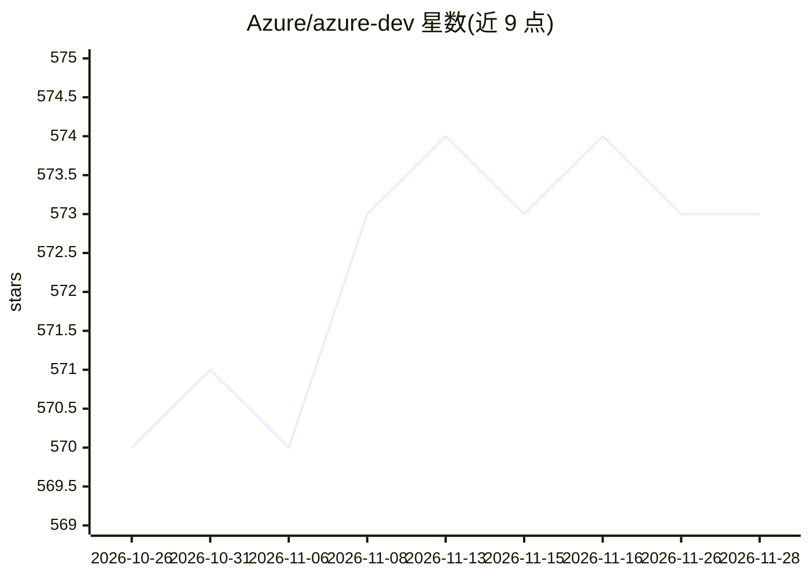

# Azure/azure-dev

⭐ 573 · Go · MIT · 推送 2026-11-27 · [GitHub](https://github.com/Azure/azure-dev) · [官网](https://aka.ms/azd) · 组织维护

**面向开发者的 Azure 应用构建部署运维 CLI**

Azure Developer CLI（azd）是面向开发者的命令行工具，用于构建、部署和运维 Azure 应用，命令对应工作流关键阶段：code、build、deploy、monitor。提供 Windows（winget）、macOS（Homebrew cask）、Linux（curl 安装脚本）安装渠道，并配套 VS Code 扩展；内置遵循 Azure 开发规范的模板，支持 bash/zsh/fish/powershell 补全，默认收集遥测数据、可通过环境变量关闭。

## 筛选速览

| 维度 | 判定 | 备注 |
|---|---|---|
| AI 角色 | `ai-ecosystem` | LLM/agent 周边工具 |
| 许可风险 | `permissive` | MIT |
| 部署形态 | `None` |  |
| 模型依赖 | — | README 未给出锁定关系 |
| 硬件要求 | — | 无带数字的原话,不猜 |
| 安装摩擦 | `low` | 无编译、无系统依赖或容器化 |
| 成熟度 | — | 结构信号不足 |

## 能力要点

- 命令映射到 code/build/deploy/monitor 工作流阶段
- 内置遵循 Azure 开发规范的模板
- 提供 winget/Homebrew/curl 脚本多平台安装与 VS Code 扩展
- 支持 bash/zsh/fish/powershell shell 补全

## 适用场景

- 从代码快速部署应用到 Azure
- 使用标准化模板管理 Azure 资源
- 在 CI/终端环境中运维 Azure 应用

## 场景标签

 · 领域:云计算/开发者工具

## 证据(README 行号)

> L3: > **From code to cloud in minutes.** A developer-centric CLI to build, deploy, and operate Azure applications.
> L24: ## 🤖 AI Agents

## 星数曲线

2026-10-26 570 → 2026-11-28 573（+3）

---
*卡片 v1 · prompt 1.4 · 生成 2026-11-26 · 置信度 mid · 依据 README sha `44ad010276e1` · [字段定义](../../DATASET.md)*
