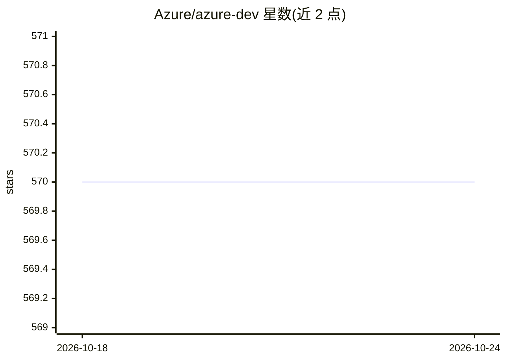

# Azure/azure-dev

⭐ 570 · Go · MIT · 推送 2026-10-23 · [GitHub](https://github.com/Azure/azure-dev) · [官网](https://aka.ms/azd) · 组织维护

**微软官方 Azure 应用开发部署 CLI（azd）**

面向开发者的 Azure 命令行工具，围绕 code、build、deploy、monitor 工作流阶段组织命令，配合遵循 Azure 开发规范的模板，实现从代码到云端应用的构建与部署。以 CLI 二进制分发，提供 Windows（winget/choco）、macOS（Homebrew cask）、Linux（安装脚本）安装方式，另有 VS Code 扩展；仓库含 AI agent 协作文档（AGENTS.md）与 Agency 配置说明。收集使用遥测数据，可通过环境变量关闭。

## 筛选速览

| 维度 | 判定 | 备注 |
|---|---|---|
| AI 角色 | `ai-ecosystem` | LLM/agent 周边工具 |
| 许可风险 | `permissive` | MIT |
| 部署形态 | `None` |  |
| 模型依赖 | — | README 未给出锁定关系 |
| 硬件要求 | — | 无带数字的原话,不猜 |
| 安装摩擦 | `low` | 无编译、无系统依赖或容器化 |
| 成熟度 | — | 结构信号不足 |

## 能力要点

- 命令映射 code/build/deploy/monitor 工作流阶段
- 官方模板遵循 Azure 开发推荐实践
- 跨平台安装（winget/Homebrew/Linux 脚本）与 VS Code 扩展
- 支持 AI 编码助手与 agent 配置（AGENTS.md、agency.toml）

## 适用场景

- 开发者用一条 CLI 工作流把应用构建并部署到 Azure
- 使用官方模板按 Azure 推荐实践初始化项目
- 在 VS Code 中配合扩展完成 Azure 应用开发运维

## 场景标签

 · 领域:云开发工具/DevOps

## 证据(README 行号)

> L1: # Azure Developer CLI (`azd`)
> L3: > **From code to cloud in minutes.** A developer-centric CLI to build, deploy, and operate Azure applications.

## 星数曲线

2026-10-18 570 → 2026-10-24 570（+0）

---
*卡片 v1 · prompt 1.4 · 生成 2026-10-21 · 置信度 high · 依据 README sha `4e3a24a72908` · [字段定义](../../DATASET.md)*
