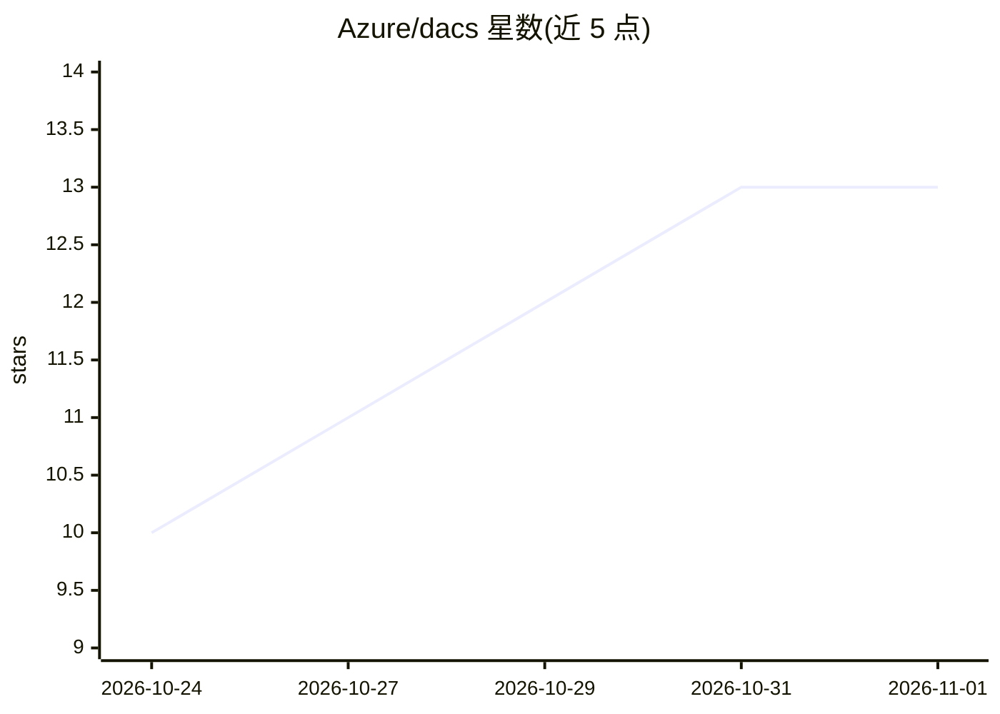

# Azure/dacs

⭐ 13 · C++ · Apache-2.0 · 推送 2026-10-30 · [GitHub](https://github.com/Azure/dacs) · 组织维护

**Kubernetes 上的云存储分布式缓存加速系统**

面向在 Kubernetes 上运行数据密集型工作负载的用户，DACS 在应用与远端对象存储之间部署高吞吐缓存层：CacheServer 使用节点本地存储（如 NVMe/RAID）缓存数据，减少重复远端读取；Kubernetes 缓存控制器通过 Cache 自定义资源创建并调和缓存工作负载，调度器将缓存 Pod 调度到有本地存储的节点。应用可通过 CacheClient、DACS Python 客户端或 StorageIntercept 访问数据。当前为预发布状态，安全模型假设单一信任域，不支持多租户集群；仅支持 Linux amd64/arm64。

## 筛选速览

| 维度 | 判定 | 备注 |
|---|---|---|
| AI 角色 | `ai-enhanced` | 去掉 AI 部分产品仍成立 |
| 许可风险 | `permissive` | Apache-2.0 |
| 部署形态 | `library` | 以包/库形式分发 |
| 模型依赖 | — | README 未给出锁定关系 |
| 硬件要求 | — | 无带数字的原话,不猜 |
| 安装摩擦 | `low` | 无编译、无系统依赖或容器化 |
| 成熟度 | `idea` | |

## 能力要点

- 节点本地存储的高吞吐分布式缓存，减少重复远端读取
- 通过 Cache 自定义资源由 Kubernetes 控制器调和缓存工作负载
- 提供 Python 客户端与 StorageIntercept 存储拦截访问路径
- OCI chart 与容器镜像可匿名拉取

## 适用场景

- 数据密集型工作loads 加速远端对象存储读取
- 在 AKS 或 Minikube 上快速试用缓存加速
- 用本地 NVMe/RAID 作为缓存介质提升数据访问吞吐

## 场景标签

 · 领域:云存储/缓存基础设施

## 证据(README 行号)

> L3: Distributed Accelerator for Cloud Storage (DACS) is a distributed caching
> L51: Applications access data through CacheClient, the DACS Python client, or

## 星数曲线

2026-10-24 10 → 2026-11-01 13（+3）

---
*卡片 v1 · prompt 1.4 · 生成 2026-10-31 · 置信度 low · 依据 README sha `3626bcce9166` · [字段定义](../../DATASET.md)*
