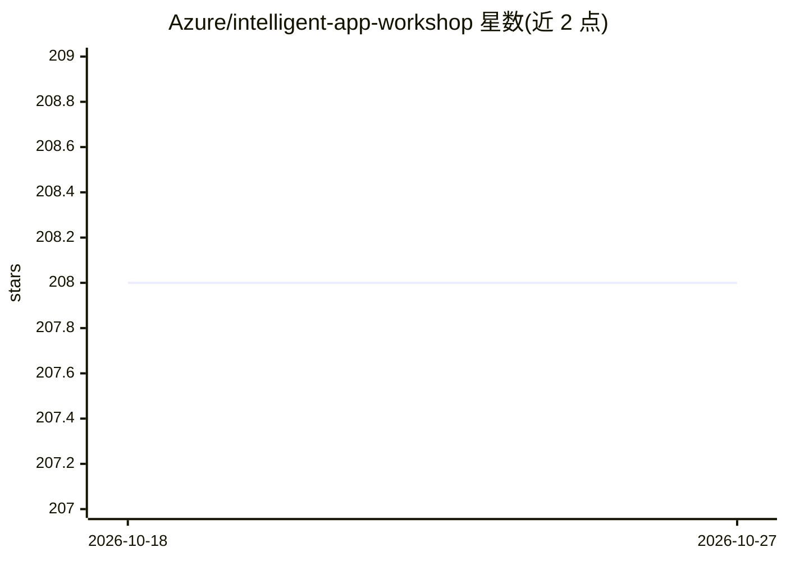

# Azure/intelligent-app-workshop

⭐ 208 · Bicep · MIT · 推送 2026-10-12 · [GitHub](https://github.com/Azure/intelligent-app-workshop) · [官网](https://copilotwksp.com) · 组织维护

**微软官方动手工坊：用 Copilot 技术栈构建自定义智能应用**

Azure 官方沉浸式工坊，指导开发者基于微软 Copilot 技术栈（Azure AI Foundry 推理引擎、Prompt Flow 做 LLMOps、AI Search 做语义检索、Semantic Kernel 做编排）构建自定义 Copilot，全程结合 Miyagi 代码库实操，并涉及 AutoGen 与 GraphRag 等能力，覆盖从需求识别到 Azure 部署的应用全生命周期。软件声明仅供演示用途、不供商业使用，采用 CC BY-SA 4.0 许可。

## 筛选速览

| 维度 | 判定 | 备注 |
|---|---|---|
| AI 角色 | `ai-knowledge` | 知识聚合/清单类 |
| 许可风险 | `permissive` | MIT |
| 部署形态 | `None` |  |
| 模型依赖 | — | README 未给出锁定关系 |
| 硬件要求 | — | 无带数字的原话,不猜 |
| 安装摩擦 | `low` | 无编译、无系统依赖或容器化 |
| 成熟度 | — | 结构信号不足 |

## 能力要点

- 使用 Azure AI Foundry、Prompt Flow、AI Search、Semantic Kernel 组成的 Copilot 技术栈
- 结合 Miyagi 代码库进行实操
- 涉及 AutoGen 与 GraphRag 能力探索
- 覆盖从用户需求到 Azure 部署的应用开发全流程

## 适用场景

- 学习如何用微软技术栈构建自定义 Copilot 应用
- 实践 LLMOps、语义检索与多智能体编排
- 了解生产级智能应用在 Azure 上的部署路径

## 场景标签

`教程课程` · 领域:学习与行业

## 证据(README 行号)

> L6: Welcome to this envisioning workshop designed to help you build your own custom Copilot using Microsoft's Copilot st
> L12: - Utilize Azure AI Foundry for reasoning engines, Prompt Flow for LLMOps, AI Search for semantic retrieval systems,

## 星数曲线

2026-10-18 208 → 2026-10-27 208（+0）

---
*卡片 v1 · prompt 1.4 · 生成 2026-10-22 · 置信度 high · 依据 README sha `2f02f9eca6e2` · [字段定义](../../DATASET.md)*
