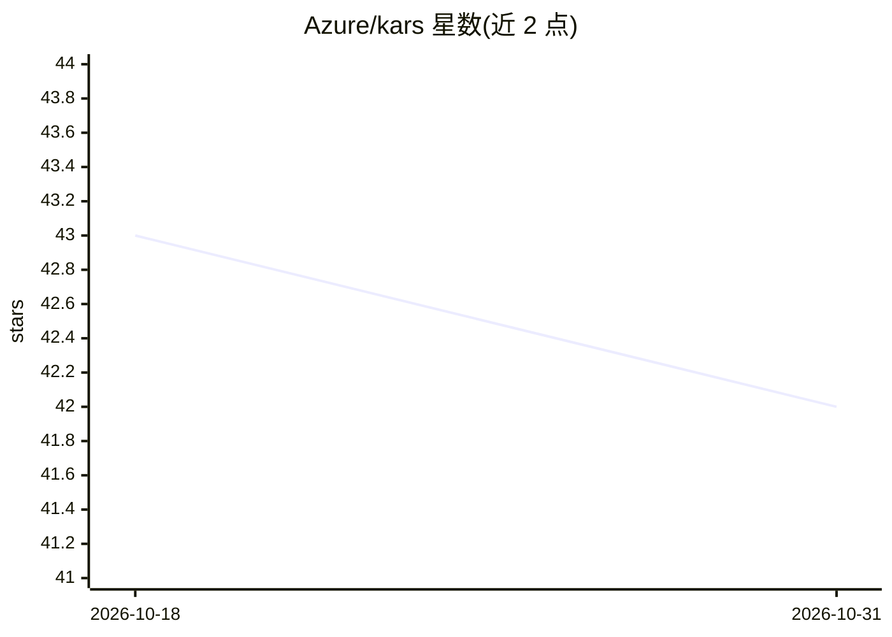

# Azure/kars

⭐ 42 · Rust · MIT · 推送 2026-10-30 · [GitHub](https://github.com/Azure/kars) · 组织维护

**微软开源的 Kubernetes AI agent 安全运行时参考栈**

由 Azure Cloud Native 团队开源的 Agent Reference Stack：在 Kubernetes 上以每个 agent 一个加固沙箱的方式运行 AI agent。核心机制是 pod 内 Rust 推理路由器——agent 进程无网络、不持有凭据，所有外部调用经路由器代理，实施身份令牌交换、内容安全、令牌预算、L7 出站白名单、MCP 网关与 SHA-256 哈希链审计日志；agent 间通信用 Signal Protocol 端到端加密。后端支持 GitHub Copilot、Azure AI Foundry、Azure OpenAI、GitHub Models，同一 KarsSandbox YAML 可在本地 kind/Docker 与 AKS 间切换。声明非微软官方支持产品，属参考实现。

## 筛选速览

| 维度 | 判定 | 备注 |
|---|---|---|
| AI 角色 | `ai-ecosystem` | LLM/agent 周边工具 |
| 许可风险 | `permissive` | MIT |
| 部署形态 | `library` | 以包/库形式分发 |
| 模型依赖 | locked-api |  |
| 硬件要求 | — | 无带数字的原话,不猜 |
| 安装摩擦 | `low` | 无编译、无系统依赖或容器化 |
| 成熟度 | — | 结构信号不足 |

## 能力要点

- 每 agent 一个加固沙箱，agent 进程无网络且不持有凭据，所有调用经 Rust 路由器代理
- Signal Protocol 端到端加密的跨框架 agent 间通信 mesh（OpenClaw ↔ Hermes 已打通）
- 策略以 Kubernetes CRD 声明（审批门、限流、工具白名单、令牌预算），支持 GitOps
- 本地 kind / Docker / AKS 三种运行方式使用相同 CRD 与审计格式

## 适用场景

- 在生产 Kubernetes 上以零信任方式运行带工具的 AI agent
- 本地 kind 集群复现生产 pod 形态做 agent 开发与验证
- 对 agent 外部调用做治理、限流与防篡改审计
- 跨框架 agent 间建立端到端加密通信

## 场景标签

`网络安全` · 领域:学习与行业

## 证据(README 行号)

> L5: **The secure, Kubernetes-native runtime for AI agents: one hardened sandbox per agent, zero credentials in the agent
> L36: - **Zero-trust agent process** — the agent runs under a different UID than the router and never sees an Azure key. 
> L73: **Why this is not the same as a cluster-edge gateway (e.g. `agentgateway`).** A north-south gateway governs traffic

## 星数曲线

2026-10-18 43 → 2026-10-31 42（-1）

---
*卡片 v1 · prompt 1.4 · 生成 2026-10-25 · 置信度 high · 依据 README sha `66029979fc2b` · [字段定义](../../DATASET.md)*
