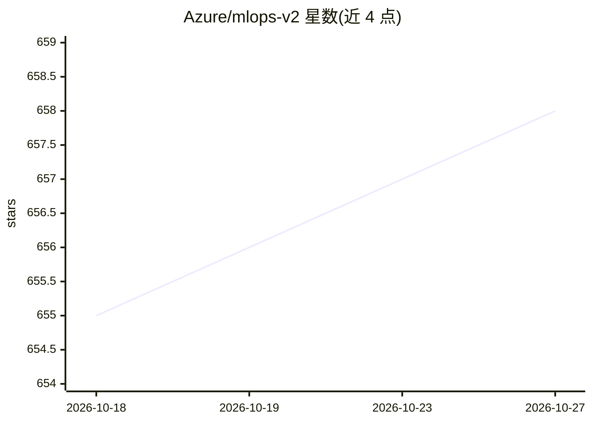

# Azure/mlops-v2

⭐ 658 · Shell · MIT · 推送 2026-06-03 · [GitHub](https://github.com/Azure/mlops-v2) · [官网](https://learn.microsoft.com/en-us/azure/machine-learning/concept-model-management-and-deployment) · 组织维护

**面向企业的 Azure MLOps 端到端部署模板加速器**

Azure 官方维护的 MLOps (v2) 解决方案加速器：提供基于模式架构的模块化、模板化方法，覆盖数据科学到模型生产部署的端到端流程，支持 Azure DevOps 与 GitHub 两种部署路径，配套概念文档、架构模式说明、部署指南与快速入门场景。前提条件包括 Azure 订阅、Azure CLI（DevOps 场景另需 azure-devops 扩展与 Terraform 扩展）、GitHub 客户端及 shell 脚本环境。组织需按自身需求定制模板。

## 筛选速览

| 维度 | 判定 | 备注 |
|---|---|---|
| AI 角色 | `ai-ecosystem` | LLM/agent 周边工具 |
| 许可风险 | `permissive` | MIT |
| 部署形态 | `None` |  |
| 模型依赖 | — | README 未给出锁定关系 |
| 硬件要求 | — | 无带数字的原话,不猜 |
| 安装摩擦 | `low` | 无编译、无系统依赖或容器化 |
| 成熟度 | — | 结构信号不足 |

## 能力要点

- 基于模式架构的模块化模板方法
- 支持 Azure DevOps 与 GitHub 两种部署路径
- 提供快速入门（Quickstarts）演示/POC 场景
- 配套概念、架构模式与部署指南文档

## 适用场景

- 在 Azure 上搭建端到端 MLOps 工作流作为起点
- 通过模板快速部署机器学习模型到生产环境
- 借助 Quickstarts 做 MLOps 演示或概念验证

## 场景标签

`MLOps` · 领域:训练与推理

## 证据(README 行号)

> L5: Welcome to the MLOps (v2) solution accelerator repository! This project is intended to serve as the starting point f
> L7: MLOps is a set of repeatable, automated, and collaborative workflows with best practices that empower teams of ML pr
> L15: The solution accelerator provides a modular end-to-end approach for MLOps in Azure based on pattern architectures. 

## 星数曲线

2026-10-18 655 → 2026-10-27 658（+3）

---
*卡片 v1 · prompt 1.4 · 生成 2026-10-21 · 置信度 high · 依据 README sha `b250d5ef308b` · [字段定义](../../DATASET.md)*
