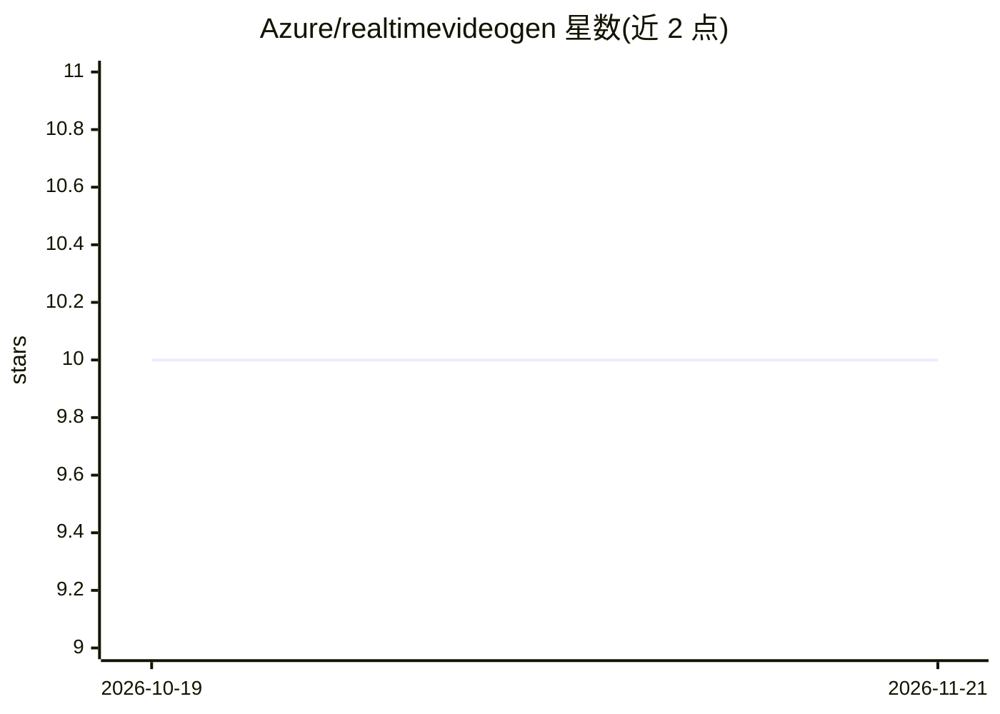

# Azure/realtimevideogen

⭐ 10 · Jupyter Notebook · MIT · 推送 2026-11-17 · [GitHub](https://github.com/Azure/realtimevideogen) · 组织维护

**面向研究者的多模态生成实时推理服务栈**

由 Azure 研究团队发布的 StreamWise：面向实时多模态生成（视频/音频/图像/LLM）的服务基础设施，聚焦调度、供给与推理执行等系统研究。机制包括：模型封装为 Docker 容器并统一 HTTP 推理接口（25+ 模型）、按时限约束的请求调度器、自适应质量调节（分辨率/FPS/采样步数）、多 GPU 与跨区域部署、Spot 优化与缓存批处理。基于 Kubernetes 部署，附 StreamCast 文档转视频播客等压力测试应用。明确声明不面向生产环境，不保证生成内容质量。

## 筛选速览

| 维度 | 判定 | 备注 |
|---|---|---|
| AI 角色 | `ai-ecosystem` | LLM/agent 周边工具 |
| 许可风险 | `permissive` | MIT |
| 部署形态 | `None` |  |
| 模型依赖 | — | README 未给出锁定关系 |
| 硬件要求 | — | 无带数字的原话,不猜 |
| 安装摩擦 | `low` | 无编译、无系统依赖或容器化 |
| 成熟度 | — | 结构信号不足 |

## 能力要点

- 封装 25+ 多模态模型为统一容器接口
- 截止时间感知的流式请求调度器
- 自适应质量（分辨率、FPS、采样步数）与 GPU 频率调节
- 基于 Kubernetes 的多 GPU、跨区域、Spot 感知部署

## 适用场景

- 搭建实时视频/音频生成的推理服务集群
- 对多模态生成负载做系统层面的调度研究
- 在延迟约束下平衡生成成本与质量

## 场景标签

`视频生成` `多模态` `推理引擎` · 领域:内容生成

## 证据(README 行号)

> L11: > This project focuses on **systems research** — specifically the infrastructure, scheduling, provisioning, and ser
> L17: - Model on-boarding for 25+ multi-modal models (video, audio, image, LLMs)
> L62: We build StreamWise on top of a Kubernetes (K8s) cluster:

## 星数曲线

2026-10-19 10 → 2026-11-21 10（+0）

---
*卡片 v1 · prompt 1.4 · 生成 2026-11-20 · 置信度 high · 依据 README sha `cf580754f4c0` · [字段定义](../../DATASET.md)*
