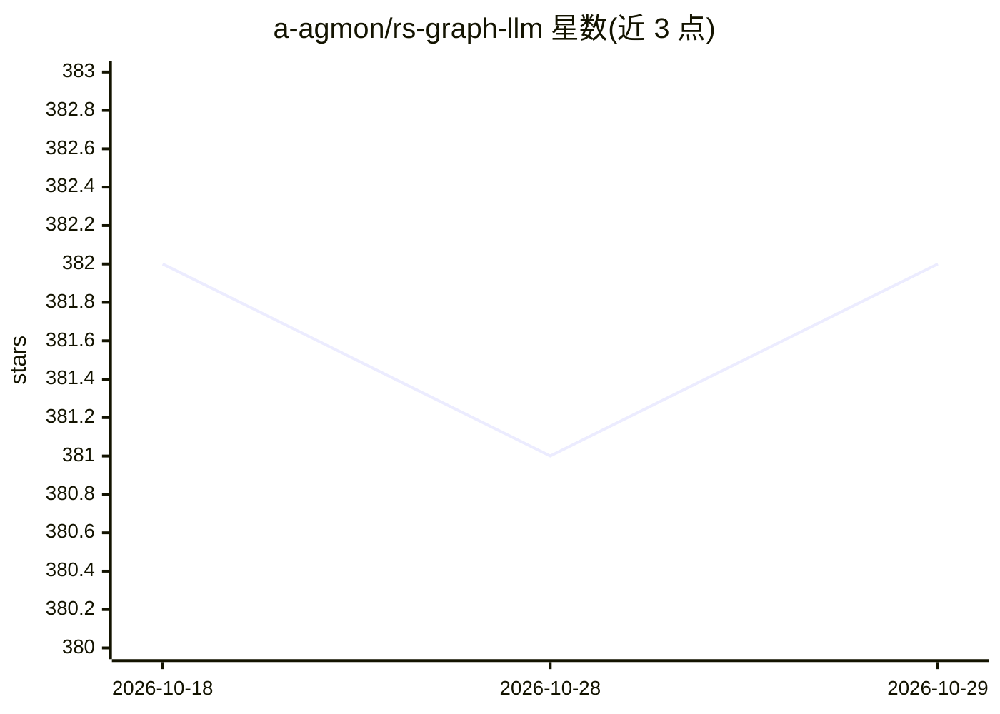

# a-agmon/rs-graph-llm

⭐ 382 · Rust · MIT · 推送 2026-10-21 · [GitHub](https://github.com/a-agmon/rs-graph-llm) · 个人维护

**面向 AI agent 的 Rust 有状态图工作流框架（LangGraph 风格）**

用 Rust 实现的 LangGraph 风格图工作流框架：任务以 Task trait 组织在图中，通过共享 Context 读写状态并返回 NextAction 控制流转，支持条件路由、人机协同暂停（WaitForInput）、跨进程重启的会话恢复、FanOut 并行执行与会话乐观锁。会话存储提供内存与 Postgres（默认特性）两种后端；可选 rig 特性经 rig-core/rig-agent 接入 LLM。附保险理赔 HTTP 服务与 RAG 推荐服务两个示例工程。以 crates.io 库形式发布，MIT 许可。

## 筛选速览

| 维度 | 判定 | 备注 |
|---|---|---|
| AI 角色 | `ai-ecosystem` | LLM/agent 周边工具 |
| 许可风险 | `permissive` | MIT |
| 部署形态 | `library` | 以包/库形式分发 |
| 模型依赖 | — | README 未给出锁定关系 |
| 硬件要求 | — | 无带数字的原话,不猜 |
| 安装摩擦 | `low` | 无编译、无系统依赖或容器化 |
| 成熟度 | — | 结构信号不足 |

## 能力要点

- Task/Context/NextAction 的类型安全图执行模型
- 人机协同暂停与跨重启的会话持久化（内存/Postgres）
- step-by-step 与 fire-and-forget 两种执行模式可混用
- 可选 rig 特性桥接 rig-core/rig-agent 的 LLM 集成

## 适用场景

- 构建可暂停、可恢复的多步骤 LLM agent 工作流
- 实现带人工审批环节的业务流程（如理赔 ≥$1000 暂停待审）
- 需要条件路由与并行分支（FanOut）的有状态服务后端

## 场景标签

`Agent 框架` · 领域:Agent 开发

## 证据(README 行号)

> L7:  *A type-safe, LangGraph-inspired framework for building complex, interactive, resumable agent workflows*
> L12: **graph-flow** combines the two ideas that make LangGraph pleasant to use — a graph execution engine for stateful w
> L15: - **Rig** — Rust-native LLM integration. The optional `rig` feature bridges `Context` chat history to `rig-core`'s 

## 星数曲线

2026-10-18 382 → 2026-10-29 382（+0）

---
*卡片 v1 · prompt 1.4 · 生成 2026-10-22 · 置信度 high · 依据 README sha `056f81cbcaed` · [字段定义](../../DATASET.md)*
