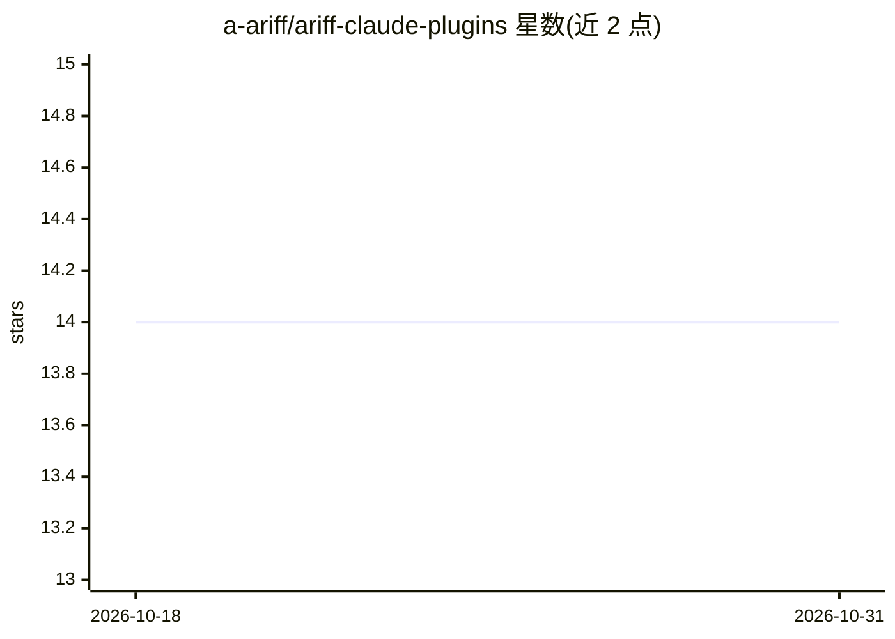

# a-ariff/ariff-claude-plugins

⭐ 14 · Shell · MIT · 推送 2026-03-28 · [GitHub](https://github.com/a-ariff/ariff-claude-plugins) · [官网](https://github.com/a-ariff/ariff-claude-plugins#quick-start) · 个人维护

**为 Claude Code 提供 65 个插件：自主代理、技能与防幻觉套件**

面向 Claude Code（Anthropic 的 CLI 编码工具）的插件集合，含 24 个代理（开发/分析/安全/专门化）、34 个技能、5 个钩子与 2 个斜杠命令，通过安装脚本复制到 ~/.claude/ 目录由 Claude Code 读取。包含 12 插件组成的防幻觉套件：钩子扫描投机性表述、代理交叉核验声明、技能要求 file:line 引用与置信度评分。要求先安装 Claude Code 与 Git，支持单插件安装、更新与卸载，覆盖 macOS/Linux/Windows（PowerShell/WSL/Git Bash）。

## 筛选速览

| 维度 | 判定 | 备注 |
|---|---|---|
| AI 角色 | `ai-ecosystem` | LLM/agent 周边工具 |
| 许可风险 | `permissive` | MIT |
| 部署形态 | `None` |  |
| 模型依赖 | — | README 未给出锁定关系 |
| 硬件要求 | — | 无带数字的原话,不猜 |
| 安装摩擦 | `low` | 无编译、无系统依赖或容器化 |
| 成熟度 | — | 结构信号不足 |

## 能力要点

- 24 个自主代理可将完整任务委派给专门化角色（如 security-analyst、architect）
- 12 插件防幻觉套件：声明核验、file:line 引用强制、0-100 置信度评分
- 钩子在 PreToolUse/Stop 等 22 种事件点自动运行
- 支持单插件安装（--plugin 参数）与一键卸载

## 适用场景

- 把代码审查、安全分析等完整任务委派给专门代理
- 在 Claude Code 工作流中加入防幻觉与输出校验机制
- 为 Claude Code 补充调试、TDD、提交信息等方法论技能

## 场景标签

`编码 Agent` `代码审查` · 领域:编码与开发

## 证据(README 行号)

> L18: Claude Code is Anthropic's CLI tool for coding with AI. **Plugins** extend what Claude Code can do by adding specia
> L20: This marketplace gives you **53 ready-to-use plugins** that turn Claude Code into an autonomous development powerho
> L104: |hallucination-guard|Hook|Scans every response for speculative language and unverified claims|

## 星数曲线

2026-10-18 14 → 2026-10-31 14（+0）

---
*卡片 v1 · prompt 1.4 · 生成 2026-10-31 · 置信度 high · 依据 README sha `94557637bef7` · [字段定义](../../DATASET.md)*
