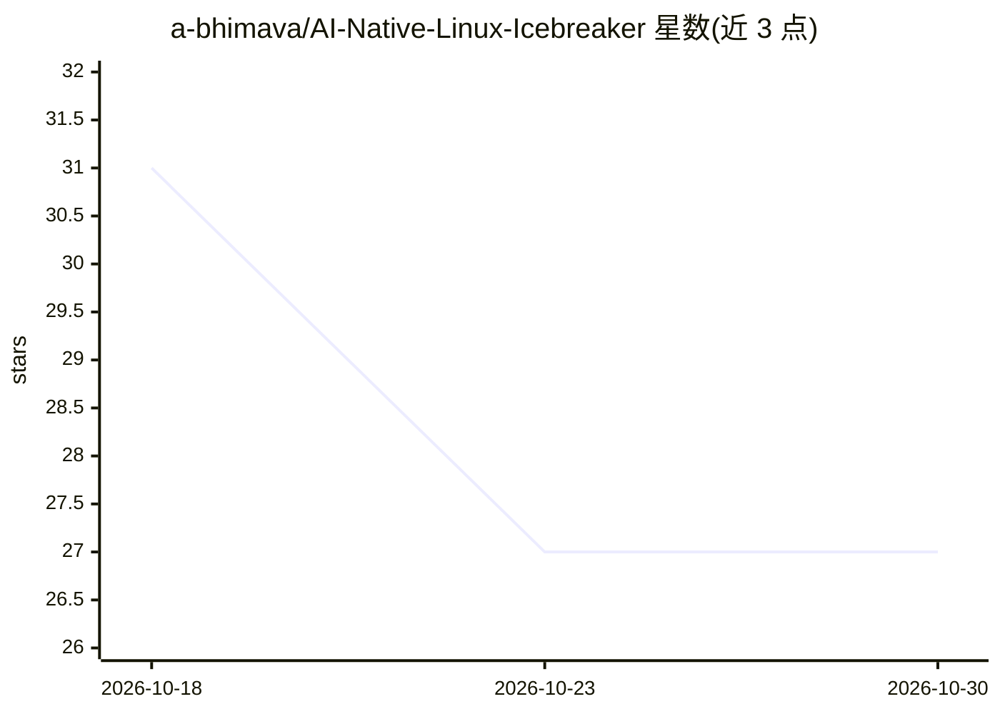

# a-bhimava/AI-Native-Linux-Icebreaker

⭐ 27 · Python · Apache-2.0 · 推送 2026-09-27 · [GitHub](https://github.com/a-bhimava/AI-Native-Linux-Icebreaker) · 个人维护

**可启动的 AI 原生 Ubuntu 系统：自然语言安全执行 Linux 操作**

基于 Ubuntu 24.04 的可启动 ISO 镜像，将自然语言意图转为 Linux 与桌面操作。核心机制是双脑隔离：云端模型负责理解对话但无执行权限，本地窄域模型（940 MB Qwen 2.5 Coder 微调，经 llama.cpp 运行、GBNF 语法约束）独占特权执行提议，配合类型化控制平面、Landlock/Seccomp-BPF 内核沙箱、COW 预览、分级人工审批与哈希链审计日志。提供 23 个系统工具与 24 个 GUI/RPA 工具。当前版本定位为发布候选，建议在 VM 中使用。

## 筛选速览

| 维度 | 判定 | 备注 |
|---|---|---|
| AI 角色 | `ai-native` | 本体是模型或模型工具 |
| 许可风险 | `permissive` | Apache-2.0 |
| 部署形态 | `None` |  |
| 模型依赖 | local-ok | 支持本地模型 |
| 硬件要求 | — | 无带数字的原话,不猜 |
| 安装摩擦 | `low` | 无编译、无系统依赖或容器化 |
| 成熟度 | `idea` | |

## 能力要点

- 双脑隔离：理解模型无特权，本地模型执行特权调用
- Landlock/Seccomp-BPF 内核沙箱与 COW 文件系统变更预览
- 23 个系统工具 + 24 个 GUI/RPA 工具（AT-SPI、视觉定位）
- 逐行 fsync 的哈希链防篡改审计日志

## 适用场景

- 用自然语言让系统检查服务、安装软件包、整理文件
- 在隔离边界内让 AI 操作桌面应用并经人工审批
- 研究 AI 与内核级权限隔离的系统架构

## 场景标签

`GUI 自动化` · 领域:效率与自动化

## 证据(README 行号)

> L11: Icebreaker is a bootable Ubuntu 24.04 system that turns plain-English intent
> L13: control plane, native kernel confinement, human approval, and tamper-evident
> L36: Icebreaker does not ask an LLM to behave securely. It **builds a system in

## 星数曲线

2026-10-18 31 → 2026-10-30 27（-4）

---
*卡片 v1 · prompt 1.4 · 生成 2026-10-26 · 置信度 high · 依据 README sha `e6066e852126` · [字段定义](../../DATASET.md)*
