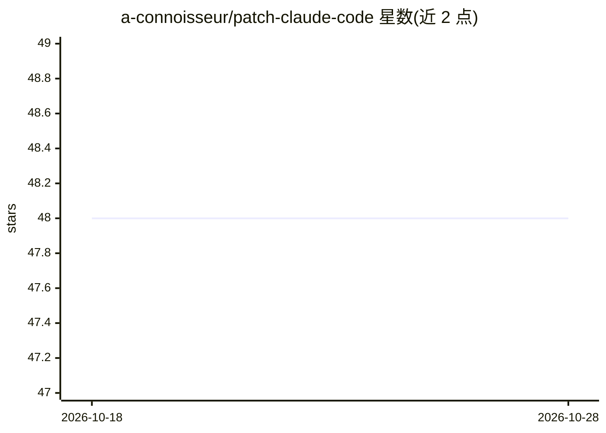

# a-connoisseur/patch-claude-code

⭐ 48 · TypeScript · 推送 2026-10-27 · [GitHub](https://github.com/a-connoisseur/patch-claude-code) · 个人维护

**为 Claude Code 发布补丁版二进制：透明显示工具调用与思考流**

发布经修改的 Claude Code 原生二进制文件，改变其输出行为：显示详细工具调用而非折叠摘要、在 UI 中实时流式输出 thinking、显示子代理 Prompt 块、禁用 spinner 提示，并将启动头改名为 Connoisseur's Code。补丁版会自动请求摘要化思考，无需手动开启设置。提供脚本与手动安装两种方式，覆盖 macOS/Linux/Windows 多架构；更新器从本仓库的补丁 release 下载并校验 SHA-256，不回退到官方未打补丁的二进制。面向希望观察 Claude Code 内部行为的开发者。

## 筛选速览

| 维度 | 判定 | 备注 |
|---|---|---|
| AI 角色 | `ai-ecosystem` | LLM/agent 周边工具 |
| 许可风险 | `none` | — |
| 部署形态 | `desktop` | 安装包/桌面程序 |
| 模型依赖 | — | README 未给出锁定关系 |
| 硬件要求 | — | 无带数字的原话,不猜 |
| 安装摩擦 | `low` | 无编译、无系统依赖或容器化 |
| 成熟度 | — | 结构信号不足 |

## 能力要点

- 显示详细工具调用与子代理 Prompt 块，无需 verbose 模式
- UI 实时流式输出 thinking
- 更新器校验 SHA-256 与补丁版本标记，仅下载补丁版 release
- 支持 macOS arm64、Linux x64/arm64、Windows x64/arm64 五个平台

## 适用场景

- 观察 Claude Code 长时间思考时是否仍在工作
- 查看 agent 实际读取的文件与执行的命令
- 以非 verbose 模式获得透明的工具调用输出

## 场景标签

 · 领域:开发者工具/AI 客户端补丁

## 证据(README 行号)

> L5: This repo publishes patched native Claude binaries that make output more transparent without verbose mode.
> L8: - Shows detailed tool calls instead of collapsed summaries.

## 星数曲线

2026-10-18 48 → 2026-10-28 48（+0）

---
*卡片 v1 · prompt 1.4 · 生成 2026-10-25 · 置信度 high · 依据 README sha `87637101b9b7` · [字段定义](../../DATASET.md)*
