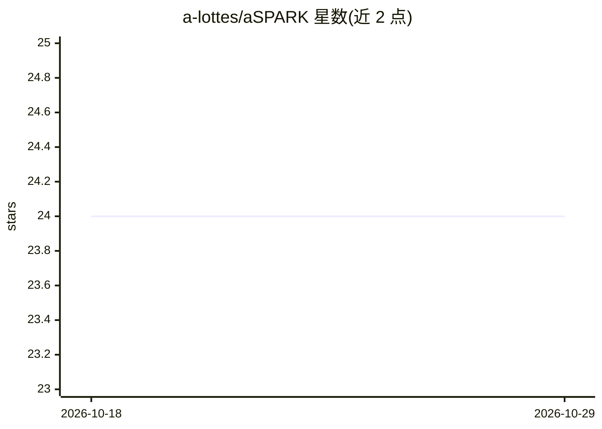

# a-lottes/aSPARK

⭐ 24 · MIT · 推送 2026-10-28 · [GitHub](https://github.com/a-lottes/aSPARK) · [官网](https://aspark.lottes.dev) · 个人维护

**Claude Code 插件：带质量门禁的敏捷 AI 产品团队流程**

以 Claude Code 插件形式提供的门禁式敏捷交付流程：由 Product Owner、Designer、Engineering Manager、Reviewer、QA、Release Manager 等角色代理组成，每个功能经历 Specify→Plan→Act→Review→Keep 五阶段，前一阶段门禁通过才能推进；QA 可在真实浏览器中逐条核验验收标准。本体是 Markdown（无服务、无账号、无运行时），在 .spark/ 目录留下可审查的过程文档。门禁为提示词约束而非代码强制，代码级强制由可选组件 aspark-guard 承担；Campaigns 功能为实验性且仅一种迁移类型。

## 筛选速览

| 维度 | 判定 | 备注 |
|---|---|---|
| AI 角色 | `ai-ecosystem` | LLM/agent 周边工具 |
| 许可风险 | `permissive` | MIT |
| 部署形态 | `library` | 以包/库形式分发 |
| 模型依赖 | locked-api |  |
| 硬件要求 | — | 无带数字的原话,不猜 |
| 安装摩擦 | `low` | 无编译、无系统依赖或容器化 |
| 成熟度 | `idea` | |

## 能力要点

- 五阶段（S/P/A/R/K）流程，每阶段设门禁，三轮失败即停下重新审视计划或规格
- 需求带稳定 ID 从规格贯穿到计划、评审与 QA
- /demo-day 在真实浏览器中逐条核验验收标准（需浏览器集成）
- 按项目类型切换 9 种 lens（如支付安全、SEO/Core Web Vitals）

## 适用场景

- 在 Claude Code 中以结构化门禁流程从想法走到发布
- 为每次功能开发留下规格、计划、评审、QA 的可审查文档链
- 对既有代码库用 /charter 记录项目画像后迭代新功能

## 场景标签

`编码 Agent` `代码审查` `多智能体` · 领域:Agent 开发

## 证据(README 行号)

> L6: aSPARK is a Claude Code plugin. No service, no account, no runtime: it is Markdown that installs into your project a
> L41: **Requirements:** Claude Code and Git. For `/demo-day` you also need a browser integration (Claude in Chrome, or a 
> L50: Then restart Claude Code. `/plugin` should list **aspark** as enabled. From a plain shell or CI, the same two steps

## 星数曲线

2026-10-18 24 → 2026-10-29 24（+0）

---
*卡片 v1 · prompt 1.4 · 生成 2026-10-27 · 置信度 mid · 依据 README sha `f247a46e44eb` · [字段定义](../../DATASET.md)*
