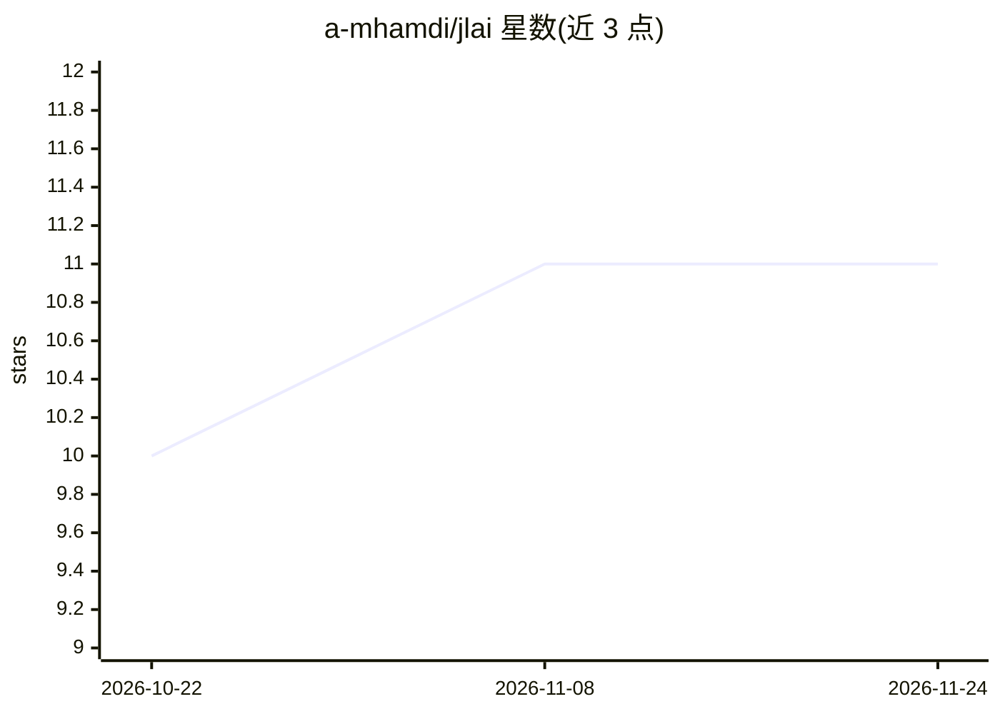

# a-mhamdi/jlai

⭐ 11 · Julia · MIT · 推送 2026-11-23 · [GitHub](https://github.com/a-mhamdi/jlai) · [官网](https://a-mhamdi.github.io/jlai/) · 个人维护

**用 Julia 学习 AI 算法的课程材料库（讲义+实验+代码）**

该仓库为使用 Julia 实现人工智能相关算法的学习材料集合，包含幻灯片、实验与代码示例。内容覆盖一阶逻辑与推理链、模糊推理系统（Mamdani/Sugeno/Tsukamoto）、经典机器学习算法、深度学习（ANN/CNN/GAN/VAE/NLP）与强化学习。代码运行在 Docker 镜像之上以保持环境一致，启动后通过 Jupyter Lab 与 Pluto 在浏览器中使用。需要本机安装 Docker 并拉取镜像，项目采用 MIT 许可证。

## 筛选速览

| 维度 | 判定 | 备注 |
|---|---|---|
| AI 角色 | `ai-knowledge` | 知识聚合/清单类 |
| 许可风险 | `permissive` | MIT |
| 部署形态 | `self-host` | docker 或自建部署 |
| 模型依赖 | — | README 未给出锁定关系 |
| 硬件要求 | — | 无带数字的原话,不猜 |
| 安装摩擦 | `low` | 无编译、无系统依赖或容器化 |
| 成熟度 | — | 结构信号不足 |

## 能力要点

- 包含 FOL、模糊推理、机器学习、深度学习、强化学习等多类算法实现
- 基于 Docker 镜像运行，保证环境一致与可复现
- 通过 docker compose 启动 Jupyter Lab 与 Pluto 两个使用入口

## 适用场景

- 跟随讲义与实验用 Julia 学习 AI 算法
- 在 Docker 容器中复现课程代码示例
- 查阅模糊逻辑与经典机器学习算法的 Julia 实现

## 场景标签

`教程课程` · 领域:学习与行业

## 证据(README 行号)

> L3: This repository contains slides, labs and code examples for using `Julia` to implement some **artificial intelligenc
> L15: The repository includes implementation of the following algorithms:

## 星数曲线

2026-10-22 10 → 2026-11-24 11（+1）

---
*卡片 v1 · prompt 1.4 · 生成 2026-11-18 · 置信度 high · 依据 README sha `972fa4245de0` · [字段定义](../../DATASET.md)*
