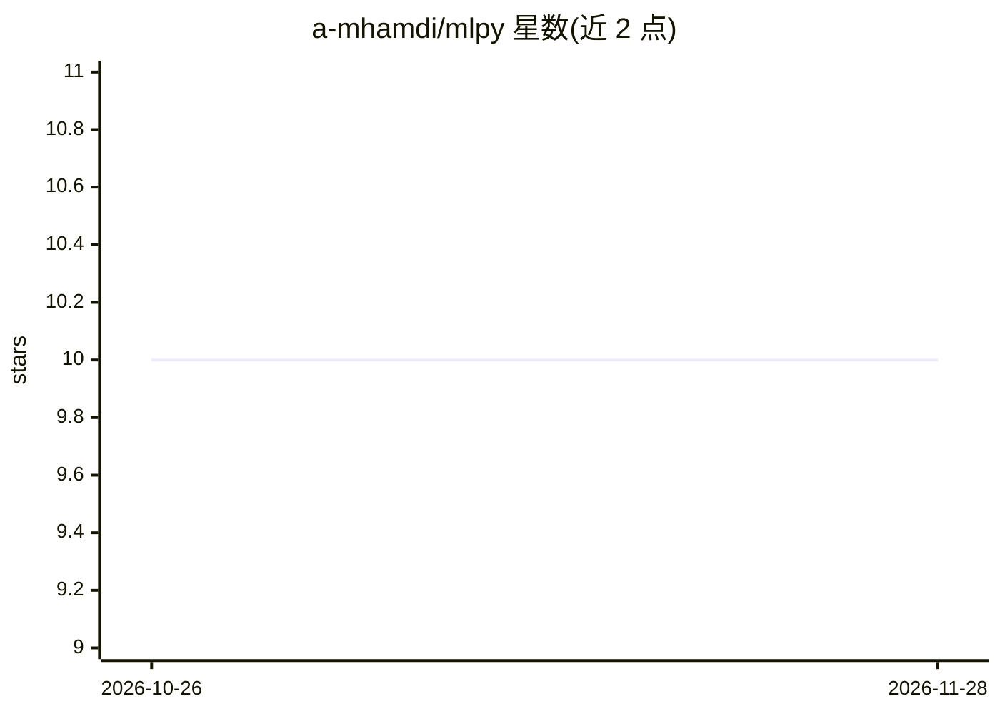

# a-mhamdi/mlpy

⭐ 10 · Python · MIT · 推送 2026-10-09 · [GitHub](https://github.com/a-mhamdi/mlpy) · [官网](https://a-mhamdi.github.io/mlpy/) · 个人维护

**用 Python 实现机器学习算法的教学材料库**

包含幻灯片、实验和代码示例的机器学习教学仓库，演示线性回归、逻辑回归、k-NN、K-MEANS、ANN 等算法的 Python 实现。运行环境封装在 Docker 镜像中以保证一致性和可复现性，docker-compose up 可启动 Jupyter Lab（端口 2468）与 Marimo（端口 1357）两种笔记本环境，采用 MIT 许可证。

## 筛选速览

| 维度 | 判定 | 备注 |
|---|---|---|
| AI 角色 | `ai-knowledge` | 知识聚合/清单类 |
| 许可风险 | `permissive` | MIT |
| 部署形态 | `self-host` | docker 或自建部署 |
| 模型依赖 | — | README 未给出锁定关系 |
| 硬件要求 | — | 无带数字的原话,不猜 |
| 安装摩擦 | `low` | 无编译、无系统依赖或容器化 |
| 成熟度 | — | 结构信号不足 |

## 能力要点

- 实现线性回归、逻辑回归、k-NN、K-MEANS、ANN 等算法
- 提供幻灯片、实验和代码示例三类教学内容
- Docker 镜像保证环境一致性与可复现性
- 同时支持 Jupyter Lab 与 Marimo 两种笔记本

## 适用场景

- 跟随课程材料学习经典机器学习算法的 Python 实现
- 在 Docker 环境中复现实验代码
- 在 Jupyter Lab 或 Marimo 中运行算法示例

## 场景标签

`教程课程` · 领域:学习与行业

## 证据(README 行号)

> L9: This repository contains slides, labs, and code samples for using `Python` to implement some **machine learning** re
> L12: The repository includes the implementation of the following algorithms:
> L21: Codes run on top of a `Docker` image, ensuring a consistent and reproducible environment.

## 星数曲线

2026-10-26 10 → 2026-11-28 10（+0）

---
*卡片 v1 · prompt 1.4 · 生成 2026-11-20 · 置信度 high · 依据 README sha `4028a288f3bc` · [字段定义](../../DATASET.md)*
