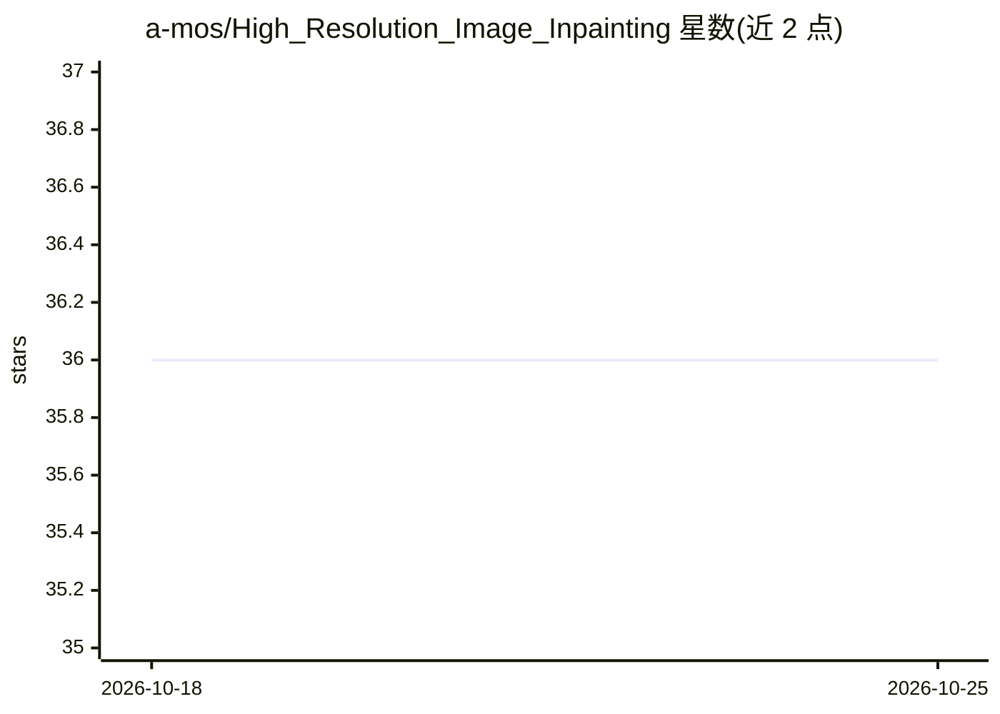

# a-mos/High_Resolution_Image_Inpainting

⭐ 36 · Python · NOASSERTION · 推送 2026-10-07 · [GitHub](https://github.com/a-mos/High_Resolution_Image_Inpainting) · 个人维护

**任意分辨率图像修复的两阶段深度方法及 GIMP 插件**

论文配套代码：提出两阶段方法解决深度修复模型受训练分辨率限制的问题，可对任意尺寸图像进行修复，并改进填充区域纹理恢复；方法可与现有修复模型配合，使其分辨率无关。提供 Python 测试脚本（Python 3.7，需下载预训练权重并运行 test.py）与 GIMP 2.10 插件（支持 Ubuntu 18.04 与 macOS Mojave，含安装脚本与视频示例）。掩膜必须为严格二值，否则填充结果差。

## 筛选速览

| 维度 | 判定 | 备注 |
|---|---|---|
| AI 角色 | `ai-native` | 本体是模型或模型工具 |
| 许可风险 | `none` | NOASSERTION |
| 部署形态 | `library` | 以包/库形式分发 |
| 模型依赖 | — | README 未给出锁定关系 |
| 硬件要求 | — | 无带数字的原话,不猜 |
| 安装摩擦 | `low` | 无编译、无系统依赖或容器化 |
| 成熟度 | — | 结构信号不足 |

## 能力要点

- 两阶段方法支持任意尺寸图像修复
- 可与现有修复模型配合使其分辨率无关
- 提供 GIMP 2.10 插件及安装脚本
- 改进填充区域的纹理恢复

## 适用场景

- 修复高分辨率或非固定尺寸图像的缺失区域
- 在 GIMP 中以插件形式交互式去除或填补图像内容
- 复现论文的两阶段修复实验

## 场景标签

`图像视频处理` · 领域:感知与多模态

## 证据(README 行号)

> L4: In recent years, the field of image inpainting has developed rapidly, but most deep methods are strongly tied to the
> L9: * Python 3.7

## 星数曲线

2026-10-18 36 → 2026-10-25 36（+0）

---
*卡片 v1 · prompt 1.4 · 生成 2026-10-25 · 置信度 high · 依据 README sha `8aa7f2c39807` · [字段定义](../../DATASET.md)*
