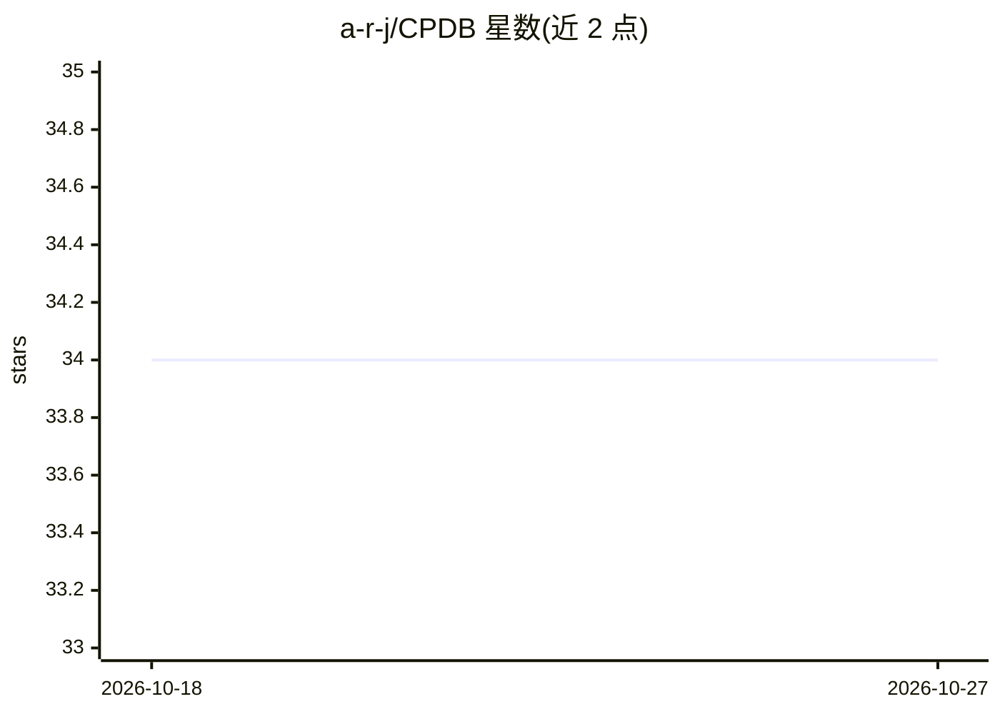

# a-r-j/CPDB

⭐ 34 · Cython · MIT · 推送 2026-10-26 · [GitHub](https://github.com/a-r-j/CPDB) · 个人维护

**Cython 实现的 PDB 蛋白质结构解析库，输出字典/DataFrame**

用 Cython 编写的 PDB 文件解析库：读取蛋白质结构文件（支持多 model），将 ATOM/HETATM 记录解析为包含原子编号、残基名、链 ID、坐标、 occupancy、B 因子等约 17 个字段的 NumPy 数组字典，或直接转换为 Pandas DataFrame；支持从磁盘文件与字符串解析。面向生物信息学与蛋白质结构分析的开发者。仓库标签含 machine-learning/deep-learning，但 README 本身未描述 AI 功能。

## 筛选速览

| 维度 | 判定 | 备注 |
|---|---|---|
| AI 角色 | `ai-ecosystem` | LLM/agent 周边工具 |
| 许可风险 | `permissive` | MIT |
| 部署形态 | `library` | 以包/库形式分发 |
| 模型依赖 | — | README 未给出锁定关系 |
| 硬件要求 | — | 无带数字的原话,不猜 |
| 安装摩擦 | `low` | 无编译、无系统依赖或容器化 |
| 成熟度 | — | 结构信号不足 |

## 能力要点

- Cython 实现的 PDB 解析，输出字段化的数组字典或 DataFrame
- 支持从磁盘文件与字符串两种来源解析
- 保留 model_idx 字段以区分多 model 结构

## 适用场景

- 我在做蛋白质结构分析，需要把 PDB 文件转成 DataFrame 处理
- 我在为机器学习流水线准备蛋白质结构特征数据

## 场景标签

 · 领域:结构生物学/生物信息学

## 证据(README 行号)

> L6: Cython implementation of PDB -> DataFrame parsing

## 星数曲线

2026-10-18 34 → 2026-10-27 34（+0）

---
*卡片 v1 · prompt 1.4 · 生成 2026-10-25 · 置信度 low · 依据 README sha `b2b736db9f5c` · [字段定义](../../DATASET.md)*
