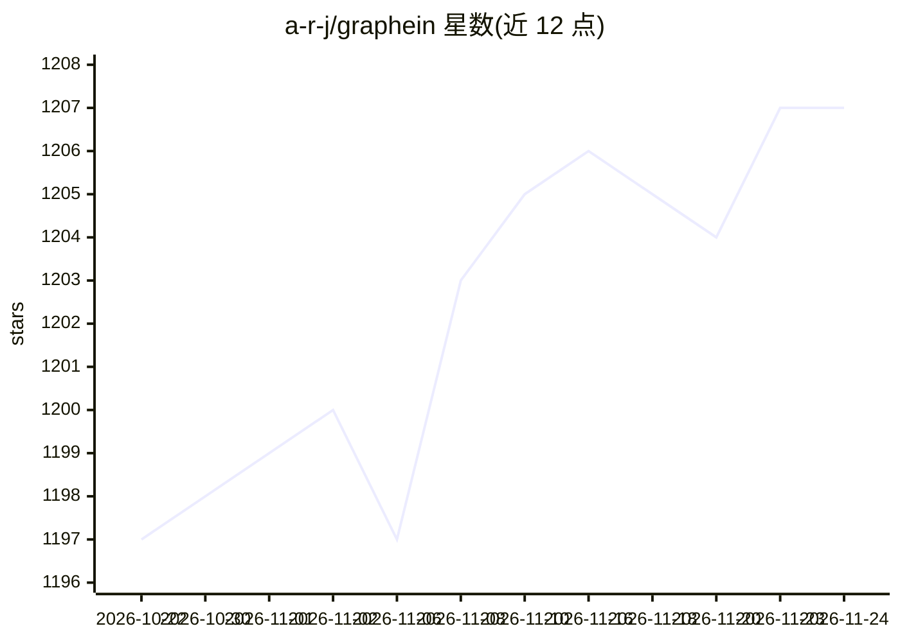

# a-r-j/graphein

⭐ 1,208 · Jupyter Notebook · MIT · 推送 2026-11-24 · [GitHub](https://github.com/a-r-j/graphein) · [官网](https://graphein.ai/) · 个人维护

**为研究者生成蛋白质/分子/网络图结构的 Python 库**

Graphein 是用于构建蛋白质、RNA 结构与生物相互作用网络几何表示的 Python 库，输出兼容 PyData 格式及 PyTorch Geometric、DGL 等深度学习库的图对象。支持从 PDB、AlphaFold 数据库、SMILES/.sdf 文件、点括号 RNA 记号等输入构建图与网格，提供程序化 API 与 YAML 配置的 CLI 批处理。pip 基础安装不含深度学习依赖；可选工具（PyMol、GetContacts）需 conda 安装。

## 筛选速览

| 维度 | 判定 | 备注 |
|---|---|---|
| AI 角色 | `ai-native` | 本体是模型或模型工具 |
| 许可风险 | `permissive` | MIT |
| 部署形态 | `self-host` | docker 或自建部署 |
| 模型依赖 | — | README 未给出锁定关系 |
| 硬件要求 | — | 无带数字的原话,不猜 |
| 安装摩擦 | `low` | 无编译、无系统依赖或容器化 |
| 成熟度 | — | 结构信号不足 |

## 能力要点

- 从 PDB、AlphaFold 数据库、SMILES、点括号记号等多来源构建蛋白质、分子、RNA、PPI、基因调控网络图
- 提供 CLI 以 YAML 配置批量处理图构建
- 提供 PyTorch Geometric 现成的 Dataloaders 与 Protein Tensor 模块
- DSSP 二级结构与溶剂可及性特征原生计算，无需安装 mkdssp

## 适用场景

- 为图神经网络准备蛋白质结构与相互作用网络的训练数据
- 从 AlphaFold 数据库批量构建蛋白结构图数据集
- 对 SMILES 或结构文件构建分子图
- 用 CLI 按配置批量处理 PDB 文件目录

## 场景标签

`科研工具` · 领域:学习与行业

## 证据(README 行号)

> L24: Protein & Interactomic Graph Library
> L26: This package provides functionality for producing geometric representations of protein and RNA structures, and biol
> L239:   title={Graphein - a Python Library for Geometric Deep Learning and Network Analysis on Biomolecular Structures a

## 星数曲线

2026-10-22 1,197 → 2026-11-24 1,207（+10）

---
*卡片 v1 · prompt 1.4 · 生成 2026-11-23 · 置信度 high · 依据 README sha `9b781a817f02` · [字段定义](../../DATASET.md)*
