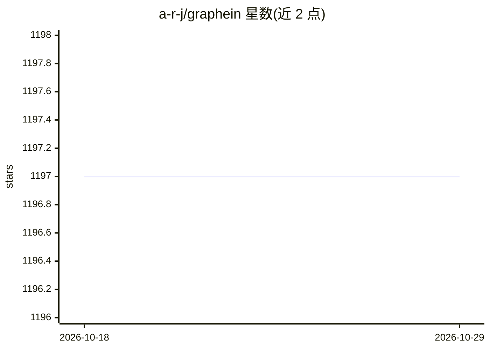

# a-r-j/graphein

⭐ 1,197 · Jupyter Notebook · MIT · 推送 2026-10-28 · [GitHub](https://github.com/a-r-j/graphein) · [官网](https://graphein.ai/) · 组织维护

**蛋白质/ RNA 结构与生物互作网络的图构建库**

面向结构生物学与计算生物学的 Python 库，将蛋白质、RNA、分子结构及蛋白质互作网络、基因调控网络转换为几何图表示，兼容 PyData 生态与主流深度学习库的图对象格式，并提供 PyTorch Geometric 的 DataLoader。支持从 PDB 与 AlphaFold 数据库构建蛋白图、从 dotbracket 构建 RNA 图、从 SMILES 构建分子图，提供 CLI 批处理与 Docker 部署。限制：pip 基础安装不含 ML/DL 库；DSSP、PyMol 等可选工具需通过 conda 安装。

## 筛选速览

| 维度 | 判定 | 备注 |
|---|---|---|
| AI 角色 | `ai-ecosystem` | LLM/agent 周边工具 |
| 许可风险 | `permissive` | MIT |
| 部署形态 | `self-host` | docker 或自建部署 |
| 模型依赖 | — | README 未给出锁定关系 |
| 硬件要求 | — | 无带数字的原话,不猜 |
| 安装摩擦 | `low` | 无编译、无系统依赖或容器化 |
| 成熟度 | — | 结构信号不足 |

## 能力要点

- 从 PDB/AlphaFold 结构构建蛋白质图（残基层/原子层）
- RNA 图（dotbracket）、分子图（SMILES/sdf/mol2/pdb）、PPI 与基因调控网络图构建
- PyTorch Geometric 等 DL 库的现成 DataLoader 与格式兼容
- 提供 Python API、CLI（yaml 配置批量处理）与 CPU/GPU Docker 部署

## 适用场景

- 把蛋白质/RNA 结构转成图数据用于几何深度学习模型训练
- 构建蛋白质互作网络或基因调控网络用于网络分析
- 批量处理 PDB 文件生成分子图数据集

## 场景标签

 · 领域:生物信息学/几何深度学习

## 证据(README 行号)

> L25: Protein & Interactomic Graph Library
> L27: This package provides functionality for producing geometric representations of protein and RNA structures, and biol
> L39: |1.3.0|Ready-to-go Dataloaders for PyTorch Geometric|Open In Colab|

## 星数曲线

2026-10-18 1,197 → 2026-10-29 1,197（+0）

---
*卡片 v1 · prompt 1.4 · 生成 2026-10-21 · 置信度 high · 依据 README sha `407850fd3501` · [字段定义](../../DATASET.md)*
