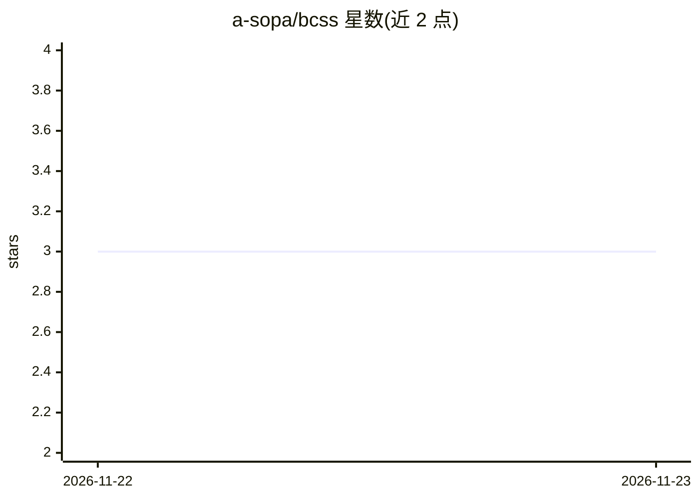

# a-sopa/bcss

⭐ 3 · Python · MIT · 推送 2026-11-20 · [GitHub](https://github.com/a-sopa/bcss) · [官网](https://a-sopa.github.io/bcss/) · 个人维护

**云弹性与安全平台：预测扩容、动态缓存、蜜罐防御与后量子审计**

面向企业的统一云韧性平台，由多个模块组成：scraper-ai 摄取体育/票务/事件数据并调用 Google Gemini 2.5 Flash 预测流量高峰；server-preheat 提前预热 AWS Lambda/实例容量；CacheManager 基于 FastAPI+Redis 动态计算缓存 TTL；cloud_honeypot_ai 提供多协议蜜罐、蜜标凭证追踪与自动封锁（NACL/SG/iptables）、AES-256-GCM 取证账本；QuantumTrace 做加密资产静态/动态审计与 PQC 就绪评估；control-plane 提供金丝雀部署与自动回滚。全套通过 Docker Compose 编排，Gemini API key 可选，缺省时回退到内置启发式引擎。

## 筛选速览

| 维度 | 判定 | 备注 |
|---|---|---|
| AI 角色 | `ai-ecosystem` | LLM/agent 周边工具 |
| 许可风险 | `permissive` | MIT |
| 部署形态 | `self-host` | docker 或自建部署 |
| 模型依赖 | — | README 未给出锁定关系 |
| 硬件要求 | — | 无带数字的原话,不猜 |
| 安装摩擦 | `low` | 无编译、无系统依赖或容器化 |
| 成熟度 | — | 结构信号不足 |

## 能力要点

- 基于事件摄取与 Gemini 2.5 Flash 的流量高峰预测（无 key 时用启发式回退）
- 多协议蜜罐（SSH/Telnet/HTTP 诱饵）+ 蜜标凭证 GPS 追踪与自动周边封锁
- FastAPI+Redis 动态 TTL 缓存与 Self-Critic 审计引擎
- QuantumTrace 加密资产审计（CBOM CycloneDX 1.6）与 PQC 风险分级

## 适用场景

- 大型活动/闪购前提前预热云容量以降低冷启动与延迟
- 用蜜罐与蜜标凭证检测被盗云密钥并自动生成封锁规则
- 审计代码库与 CI/CD 中的后量子加密风险
- 通过预测性缓存降低付费第三方 API 调用量

## 场景标签

`网络安全` `工作流自动化` · 领域:效率与自动化

## 证据(README 行号)

> L19: |**`scraper-ai`**|**Previsão de Tráfego & IA**|Ingestão de eventos reais (Futebol, Ticketmaster, PredictHQ, Manual,
> L105: - **Docker Engine** (v24.0+) and **Docker Compose v2** (`docker compose`)
> L129: docker compose up -d --build

## 星数曲线

2026-11-22 3 → 2026-11-23 3（+0）

---
*卡片 v1 · prompt 1.4 · 生成 2026-11-22 · 置信度 mid · 依据 README sha `09f8a6c36884` · [字段定义](../../DATASET.md)*
