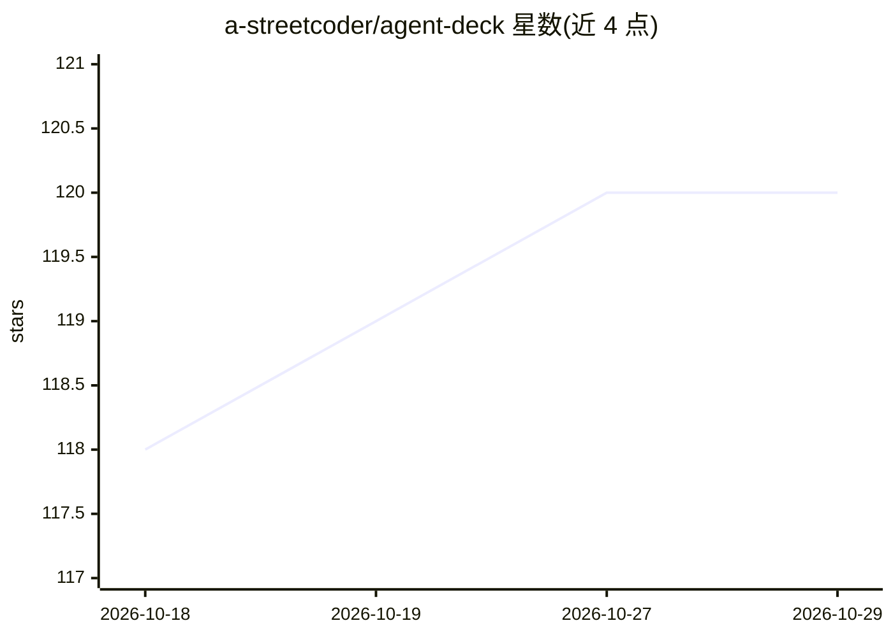

# a-streetcoder/agent-deck

⭐ 120 · Swift · MIT · 推送 2026-08-01 · [GitHub](https://github.com/a-streetcoder/agent-deck) · [官网](https://agentdeck.site) · 个人维护

**运行 Pi 编码 agent 的原生 macOS 工作台应用**

面向 macOS 用户的 SwiftUI 原生桌面应用，调用本地已安装的 Pi CLI 并以 JSONL RPC 模式启动其会话，围绕 Pi 提供 agent/技能/提示词/斜杠命令的组织管理、并行 git worktree 隔离、子代理委派、模型与提供商浏览、Markdown 记忆与密钥脱敏等功能。自身不是替代运行时，也不是 Web 封装。要求 macOS 26 Tahoe 与 Apple Silicon，通过安装脚本或签名 DMG 安装，源码构建需 Xcode 26.4+。内置单个隐私最小化的 app_opened 分析事件（PostHog EU 托管）。

## 筛选速览

| 维度 | 判定 | 备注 |
|---|---|---|
| AI 角色 | `ai-ecosystem` | LLM/agent 周边工具 |
| 许可风险 | `permissive` | MIT |
| 部署形态 | `None` |  |
| 模型依赖 | — | README 未给出锁定关系 |
| 硬件要求 | — | 无带数字的原话,不猜 |
| 安装摩擦 | `medium` | 含编译或系统依赖之一 |
| 成熟度 | — | 结构信号不足 |

## 能力要点

- 以 JSONL RPC 模式启动已安装的 Pi CLI 并管理其会话
- 并行会话/子代理使用隔离 git worktree，可合并回主分支
- 内置资源只读、写目标事前展示、记忆写入密钥扫描
- 签名并公证的 DMG 发布，Sparkle 应用内更新

## 适用场景

- 在 Mac 上集中运行和观察多个 Pi 编码 agent 会话
- 从 GitHub issue 出发在隔离分支/worktree 中完成开发并合并
- 按项目组织 agent、技能、提示词与斜杠命令

## 场景标签

`编码 Agent` · 领域:编码与开发

## 证据(README 行号)

> L3:  The native Mac app for running Pi coding agents with clarity and control.
> L18: Pi is the coding agent. Agent Deck is the native macOS workspace around it — not a replacement runtime and not a we
> L35: - Use Doctor and onboarding to find, install, and update Pi.

## 星数曲线

2026-10-18 118 → 2026-10-29 120（+2）

---
*卡片 v1 · prompt 1.4 · 生成 2026-10-23 · 置信度 high · 依据 README sha `a549bbc72e97` · [字段定义](../../DATASET.md)*
