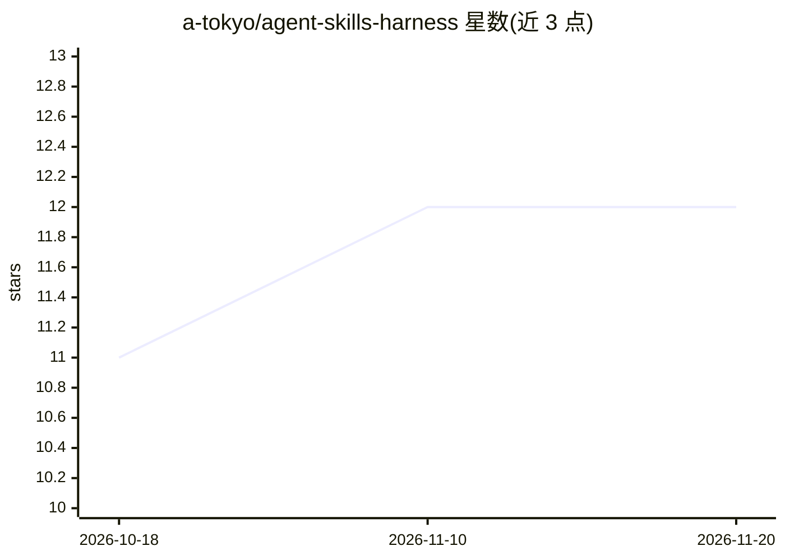

# a-tokyo/agent-skills-harness

⭐ 12 · Python · MIT · 推送 2026-11-08 · [GitHub](https://github.com/a-tokyo/agent-skills-harness) · [官网](https://agent-skills-harness.ahmedtokyo.com) · 个人维护

**给 AI 编码代理用户构建生产级 agent 技能的流水线工厂**

核心交付物是 create-skill-autoresearch 技能，将技能创建生命周期组织为 5 阶段流水线：访谈确定目标、并行子代理研究领域资料、按官方创作规则起草、以 LLM-as-judge（或真实指标）为目标分数自迭代、再由含魔鬼代言人的独立小组共识验证后才交付。用户需提供 3 个以上 gold standards 示例；无 judge 端点时回退到确定性结构检查，且该分数与 judge 分数不可比。仓库与技能注册表分离，构建产物发布到 skills 目录。

## 筛选速览

| 维度 | 判定 | 备注 |
|---|---|---|
| AI 角色 | `ai-ecosystem` | LLM/agent 周边工具 |
| 许可风险 | `permissive` | MIT |
| 部署形态 | `library` | 以包/库形式分发 |
| 模型依赖 | — | README 未给出锁定关系 |
| 硬件要求 | — | 无带数字的原话,不猜 |
| 安装摩擦 | `low` | 无编译、无系统依赖或容器化 |
| 成熟度 | — | 结构信号不足 |

## 能力要点

- 5 阶段技能创建流水线：访谈→研究→起草→自迭代→独立共识验证
- LLM-as-judge 评分迭代，无 judge 时回退确定性结构检查
- 支持升级现有技能/迁移技能集合，输出前后对比测量
- 自带 self-test 回归测试，新克隆即可离线运行

## 适用场景

- 为特定领域批量生产符合 SKILL.md 规范的 agent 技能
- 带基准地升级或迁移已有的技能集合
- 在 AI 编码代理中用一句话触发技能工厂并逐步调整产出

## 场景标签

`提示工程` · 领域:Agent 开发

## 证据(README 行号)

> L12: The core deliverable is **`create-skill-autoresearch`** — an agent skill that runs the entire
> L13: skill-creation lifecycle as a 5-phase pipeline:
> L28: - An AI coding agent that supports the `SKILL.md` format (Claude Code, Cursor, Gemini CLI, …)

## 星数曲线

2026-10-18 11 → 2026-11-20 12（+1）

---
*卡片 v1 · prompt 1.4 · 生成 2026-11-18 · 置信度 high · 依据 README sha `be2094c0ccca` · [字段定义](../../DATASET.md)*
