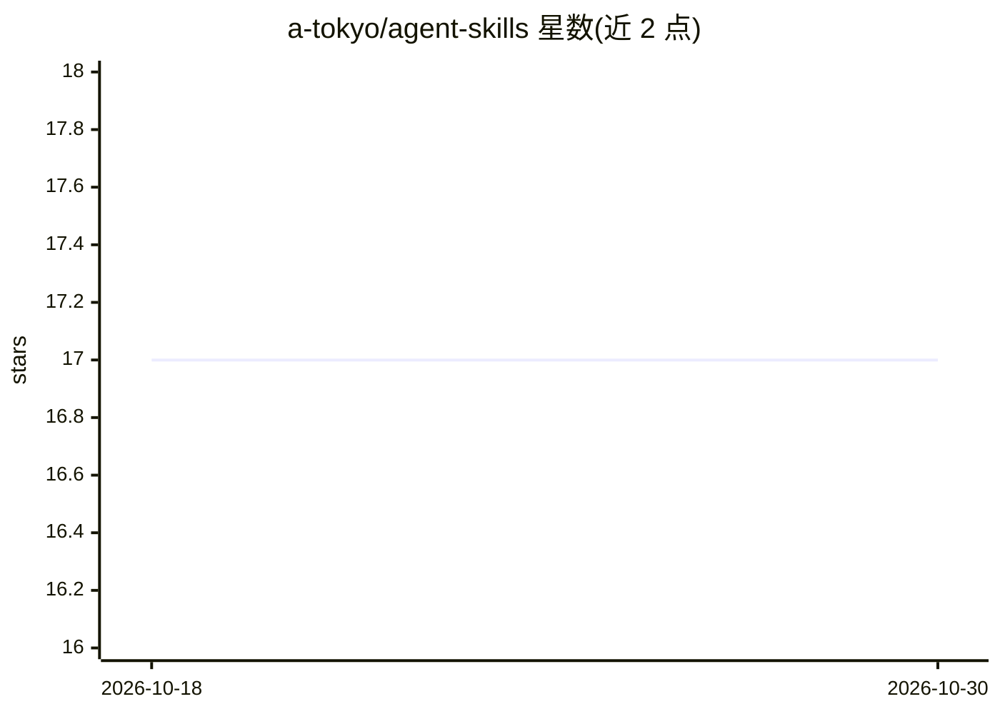

# a-tokyo/agent-skills

⭐ 17 · JavaScript · MIT · 推送 2026-10-27 · [GitHub](https://github.com/a-tokyo/agent-skills) · [官网](https://skills.sh/a-tokyo/agent-skills) · 个人维护

**面向 AI 编码助手的可复用技能集合（6 个技能）**

为 AI coding assistant 提供的一组 agent skills：涵盖 production-grade 工程原则姿态、Tailwind v3→v4 迁移、技能自研工厂（create-skill-autoresearch）、多验证者裁决面板（tribunal）、数据库文档生成与 AI 护栏脚手架等。通过 `npx skills add` 安装，兼容 Cursor、Claude Code、Codex 及 40+ agent；Claude Desktop 用户可下载各技能的 .zip 手动上传。每个技能附同模型有/无技能对比基准（执行打分、含诚实负例），基准目录不随技能发布。

## 筛选速览

| 维度 | 判定 | 备注 |
|---|---|---|
| AI 角色 | `ai-knowledge` | 知识聚合/清单类 |
| 许可风险 | `permissive` | MIT |
| 部署形态 | `desktop` | 安装包/桌面程序 |
| 模型依赖 | — | README 未给出锁定关系 |
| 硬件要求 | — | 无带数字的原话,不猜 |
| 安装摩擦 | `low` | 无编译、无系统依赖或容器化 |
| 成熟度 | — | 结构信号不足 |

## 能力要点

- 6 个技能覆盖工程原则、框架迁移、技能自研、验证裁决、文档生成与护栏脚手架
- `npx skills add` 一条命令安装，兼容 Cursor/Claude Code/Codex 等 40+ agent
- 每技能自带同模型 uplift 基准，按执行结果打分并含诚实负例
- Claude Desktop（无 CLI）可下载技能 .zip 手动上传

## 适用场景

- 给我的编码 agent 安装技能以约束其产出工程级代码
- 让 agent 完成项目从 Tailwind v3 到 v4 的完整迁移
- 通过 tribunal 验证面板对 agent 产出做多验证者裁决

## 场景标签

`提示工程` · 领域:Agent 开发

## 证据(README 行号)

> L3: Reusable agent skills for AI coding assistants. Compatible with Cursor, Claude Code, Codex, and 40+ agents via `npx 
> L7: ## Skills

## 星数曲线

2026-10-18 17 → 2026-10-30 17（+0）

---
*卡片 v1 · prompt 1.4 · 生成 2026-10-29 · 置信度 high · 依据 README sha `283ee0068ab4` · [字段定义](../../DATASET.md)*
