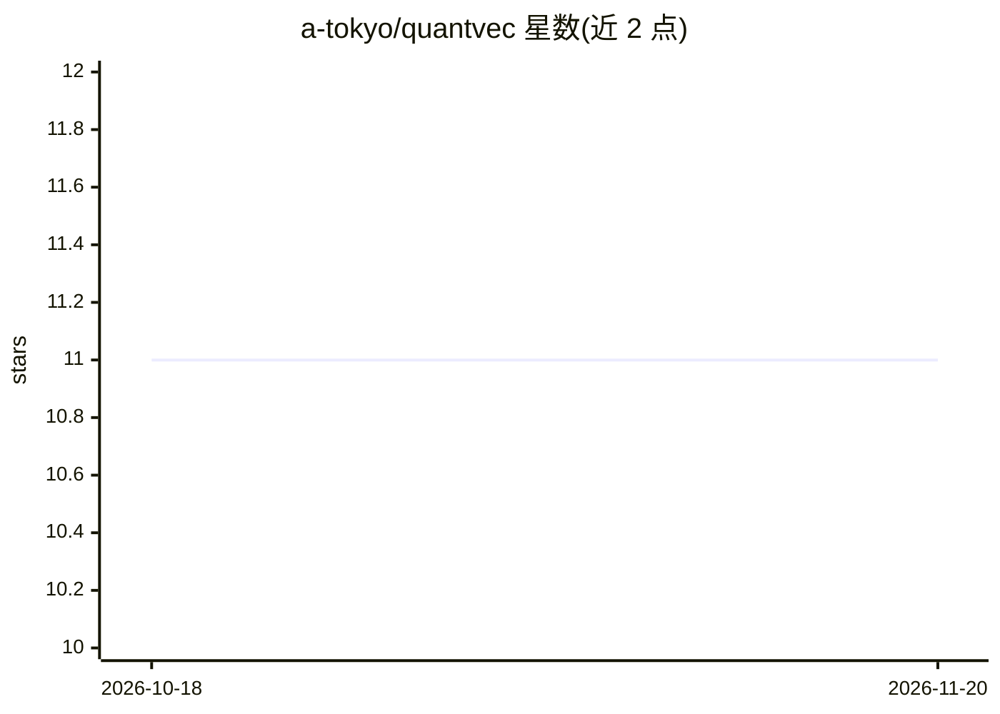

# a-tokyo/quantvec

⭐ 11 · TypeScript · Apache-2.0 · 推送 2026-09-17 · [GitHub](https://github.com/a-tokyo/quantvec) · [官网](https://quantvec.ahmedtokyo.com) · 个人维护

**给 JS/TS 开发者的零训练向量量化与最近邻检索库**

TypeScript 实现的向量量化索引库，clean-room 复现 Google Research 的 TurboQuant，并加入 RaBitQ 无偏估计修正。随机旋转加固定码本，无需训练阶段，2/3/4 位打包实现 7.9–15.7× 压缩；可选 WASM v128 FastScan 加速查询，可选 IVF 粗量化器做亚线性搜索。零运行时依赖，运行于 Node、浏览器、Bun、Cloudflare Workers、React Native，支持 cosine/dot/euclidean 度量与序列化持久化。README 标明范围是平坦量化索引（类似 FAISS IndexPQFastScan）。

## 筛选速览

| 维度 | 判定 | 备注 |
|---|---|---|
| AI 角色 | `ai-native` | 本体是模型或模型工具 |
| 许可风险 | `permissive` | Apache-2.0 |
| 部署形态 | `library` | 以包/库形式分发 |
| 模型依赖 | — | README 未给出锁定关系 |
| 硬件要求 | — | 无带数字的原话,不猜 |
| 安装摩擦 | `low` | 无编译、无系统依赖或容器化 |
| 成熟度 | — | 结构信号不足 |

## 能力要点

- 数据无关、零训练的量化：码本由 (dim, bits, seed) 确定
- 2/3/4 位真实位打包，7.9–15.7× 压缩
- 可选 WASM v128 FastScan（4 位）与 IVF 粗量化器
- 零运行时依赖，支持多运行时与 Uint8Array 持久化

## 适用场景

- 在 Node/浏览器/边缘运行时里为嵌入向量建量化索引
- 在不能跑 k-means 或无法携带训练模型的进程内做向量检索
- 为大批量 OpenAI 嵌入压缩存储并保持召回率
- 在内存中实现带 payload 过滤的向量集合查询

## 场景标签

`向量数据库` `模型量化` · 领域:知识与检索

## 证据(README 行号)

> L3: **Data-oblivious, zero-training vector quantization & nearest-neighbor search for TypeScript.**
> L25: |Training required|**No** — rotation + codebook fixed by (dim, bits, seed)|
> L28: |Runtimes|Node · Browser · Bun · Cloudflare Workers · React Native|

## 星数曲线

2026-10-18 11 → 2026-11-20 11（+0）

---
*卡片 v1 · prompt 1.4 · 生成 2026-11-18 · 置信度 high · 依据 README sha `3aa00bc9f9e1` · [字段定义](../../DATASET.md)*
