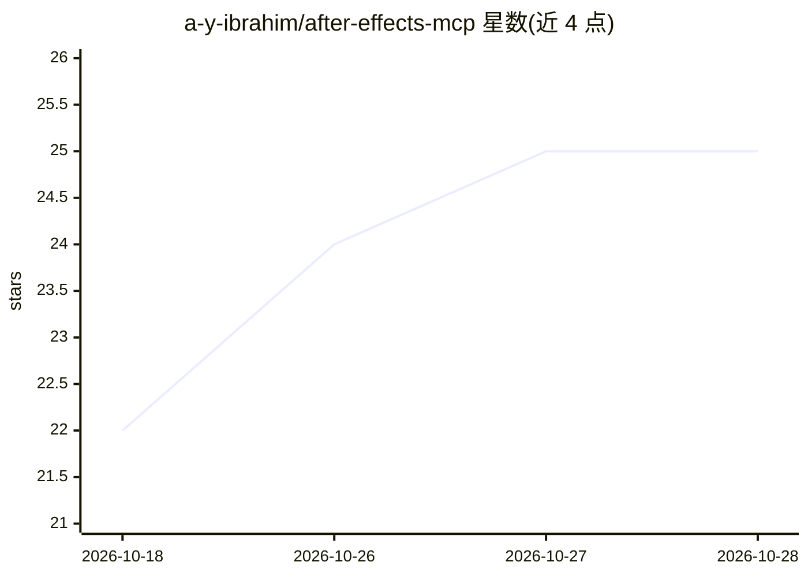

# a-y-ibrahim/after-effects-mcp

⭐ 26 · JavaScript · MIT · 推送 2026-10-10 · [GitHub](https://github.com/a-y-ibrahim/after-effects-mcp) · 个人维护

**让 AI 客户端用自然语言控制 After Effects 的 MCP 服务器（57 工具）**

基于 Dakkshin/after-effects-mcp 的增强版 MCP 服务器：通过 Node 进程与安装进 AE 的 ScriptUI 面板（bridge）通信，使 Claude 等 MCP 客户端以自然语言创建/检查合成与图层、做动画、应用效果与预设、管理遮罩/摄像机、入队渲染或后台 aerender，并可用 execute-script 运行任意 ExtendScript。特性包括 see-frame 渲染帧回传图像供 AI 自查、使用 locale 无关 matchName 兼容任意 AE 界面语言、阿拉伯语/RTL 文本自动检测与设置。要求 After Effects 2022+（Windows/macOS）、Node 18+，git clone 后 npm 安装并注册到 MCP 客户端。

## 筛选速览

| 维度 | 判定 | 备注 |
|---|---|---|
| AI 角色 | `ai-ecosystem` | LLM/agent 周边工具 |
| 许可风险 | `permissive` | MIT |
| 部署形态 | `library` | 以包/库形式分发 |
| 模型依赖 | — | README 未给出锁定关系 |
| 硬件要求 | — | 无带数字的原话,不猜 |
| 安装摩擦 | `low` | 无编译、无系统依赖或容器化 |
| 成熟度 | — | 结构信号不足 |

## 能力要点

- 57 个工具覆盖合成/图层/动画/效果/预设/音频/渲染/脚本执行
- see-frame 将帧渲染回图像供 AI 检查自身操作结果
- locale 无关 matchName，兼容阿拉伯语/法语/德语/日语界面 AE
- 阿拉伯语文本自动设置 RTL 方向与右对齐；后台 aerender 渲染不冻结 UI

## 适用场景

- 用 Claude 等客户端通过对话完成 AE 动效制作与渲染
- 让 AI 逐帧检查合成效果并自动修正
- 阿拉伯语/多语言团队的 AE 自动化工作流

## 场景标签

`图像视频处理` · 领域:感知与多模态

## 证据(README 行号)

> L9: Control Adobe After Effects from any MCP client (Claude Code / Claude Desktop) using natural
> L64: claude mcp add AfterEffectsMCP node /absolute/path/to/after-effects-mcp/build/index.js

## 星数曲线

2026-10-18 22 → 2026-10-28 25（+3）

---
*卡片 v1 · prompt 1.4 · 生成 2026-10-27 · 置信度 high · 依据 README sha `afeec8cffc44` · [字段定义](../../DATASET.md)*
