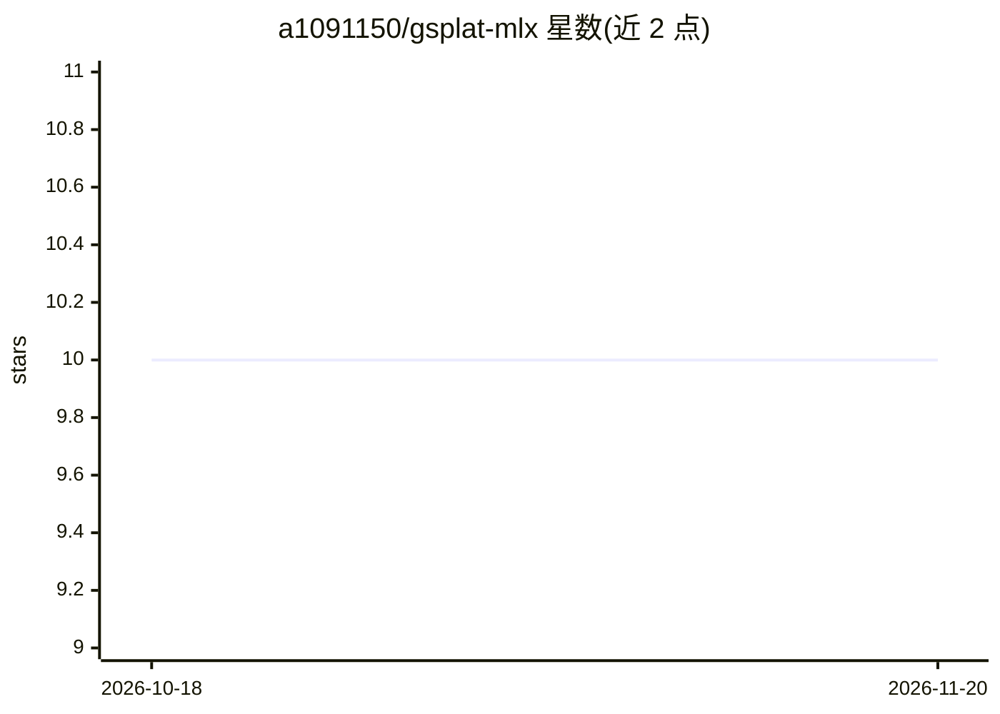

# a1091150/gsplat-mlx

⭐ 10 · Python · MIT · 推送 2026-07-29 · [GitHub](https://github.com/a1091150/gsplat-mlx) · [官网](https://a1091150.github.io/gsplat-mlx/) · 个人维护

**Apple Silicon 上的 3D Gaussian Splatting MLX 扩展库**

面向 Apple Silicon 的 CMake MLX C++ 自定义扩展项目，用 mlx core primitive 与自定义 Metal kernel 实现 3D Gaussian Splatting 算子，经 nanobind 提供 Python 绑定，并通过 gsplat CUDA 导出的 npz fixture 做一致性测试。附带 mlx Python 训练脚本，支持图像拟合、iPhone LiDAR 扫描采集与 COLMAP / Mip-NeRF 360 数据集训练及 SPZ 导出；采用 4000 步训练设置替代 gsplat 的 30000 步。项目也可作为编写 MLX C++ 自定义扩展的模板，未实现 packed sparse、segmented sort 等 gsplat 路径。

## 筛选速览

| 维度 | 判定 | 备注 |
|---|---|---|
| AI 角色 | `ai-native` | 本体是模型或模型工具 |
| 许可风险 | `permissive` | MIT |
| 部署形态 | `desktop` | 安装包/桌面程序 |
| 模型依赖 | — | README 未给出锁定关系 |
| 硬件要求 | — | 无带数字的原话,不猜 |
| 安装摩擦 | `high` | 编译与系统依赖俱全 |
| 成熟度 | — | 结构信号不足 |

## 能力要点

- mlx C++ primitives + 自定义 Metal kernel 实现 3DGS 算子
- nanobind Python 绑定，与 gsplat CUDA 输出做 parity 测试
- 支持 6 类数据源训练，含 iPhone LiDAR 扫描采集
- Xcode 工作流支持 Metal 代码调试与 GPU trace

## 适用场景

- 在 MacBook 上训练 3D Gaussian Splatting 场景
- 将 iPhone LiDAR 扫描导出为可训练的 3DGS 数据
- 参考其结构编写 MLX C++ 自定义扩展

## 场景标签

 · 领域:3D 视觉/机器学习库

## 证据(README 行号)

> L5: `gsplat_core` is a CMake-based mlx custom extension project for Apple Silicon.
> L6: It implements 3D Gaussian Splatting operators with mlx c++ primitives, custom
> L19: - mlx python training scripts for image fitting, scanner captures, COLMAP / Mip-NeRF 360-style scenes, and SPZ expo

## 星数曲线

2026-10-18 10 → 2026-11-20 10（+0）

---
*卡片 v1 · prompt 1.4 · 生成 2026-11-20 · 置信度 high · 依据 README sha `b9d57469f38a` · [字段定义](../../DATASET.md)*
