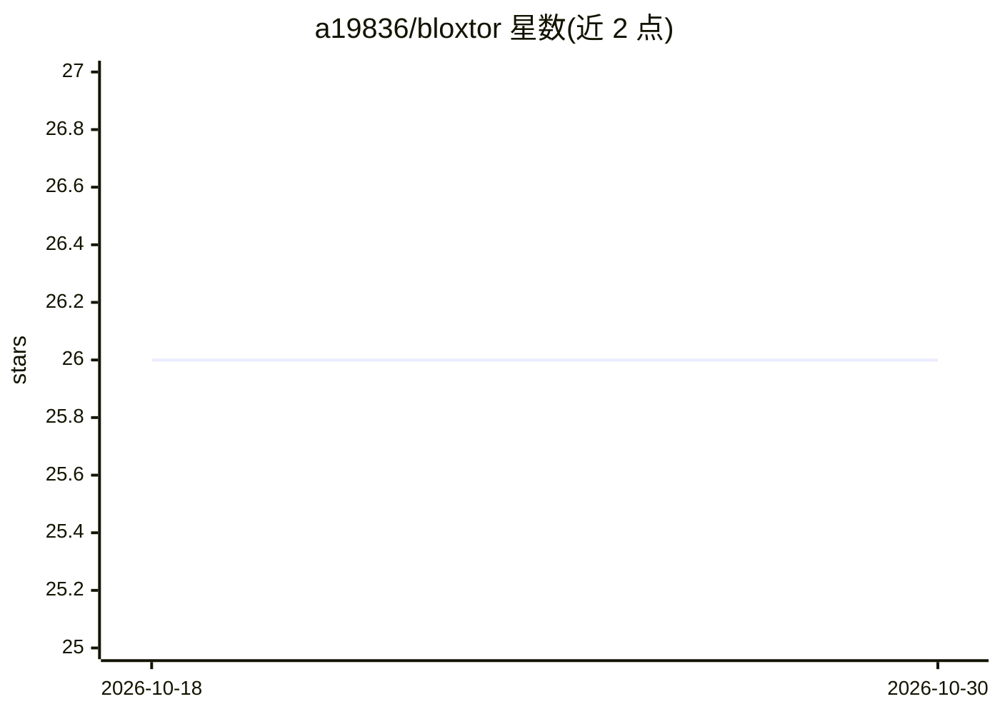

# a19836/bloxtor

⭐ 26 · PHP · NOASSERTION · 推送 2026-09-09 · [GitHub](https://github.com/a19836/bloxtor) · [官网](https://www.bloxtor.com) · 个人维护

**面向无代码/低代码/代码开发者的可视化 Web 应用构建框架**

基于 PHP（5.6+，测试至 8.4）的 Web 开发框架，支持无代码、低代码与传统代码三种工作环境，核心机制是代码与可视化环境的双向转换：可将既有代码解析为可视化组件，也可将可视化组件转回代码。功能包括自动代码生成、拖拽式页面创建、数据库反向工程与管理、多团队权限协作、单体或微服务部署。AI 能力体现为自然语言创建应用及开发流程中的 AI 辅助。安装说明位于 INSTALL.md，提供 Docker 与本地部署两种方式。

## 筛选速览

| 维度 | 判定 | 备注 |
|---|---|---|
| AI 角色 | `ai-enhanced` | 去掉 AI 部分产品仍成立 |
| 许可风险 | `none` | NOASSERTION |
| 部署形态 | `None` |  |
| 模型依赖 | — | README 未给出锁定关系 |
| 硬件要求 | — | 无带数字的原话,不猜 |
| 安装摩擦 | `low` | 无编译、无系统依赖或容器化 |
| 成熟度 | — | 结构信号不足 |

## 能力要点

- 代码与可视化环境双向转换（代码解析与反向工程）
- 无代码/低代码/代码三种开发环境可切换
- 多团队多项目管理与自定义权限控制
- 支持单体或微服务架构部署

## 适用场景

- 非技术人员用可视化方式搭建 Web 应用
- 开发者在无代码与源码模式间切换协作开发
- 对既有代码和数据库做反向工程并可视化管理

## 场景标签

`代码生成` · 领域:编码与开发

## 证据(README 行号)

> L5: Bloxtor is a **professional and intelligent web-development framework designed for No-Coders, Low-Coders, and Coders
> L44: The goal is to develop a framework that serves as the primary development resource for web applications across all 
> L78: This is the Bloxtor version for PHP 5.6 or higher (tested until PHP8.4).

## 星数曲线

2026-10-18 26 → 2026-10-30 26（+0）

---
*卡片 v1 · prompt 1.4 · 生成 2026-10-26 · 置信度 mid · 依据 README sha `05a4df9bc1aa` · [字段定义](../../DATASET.md)*
