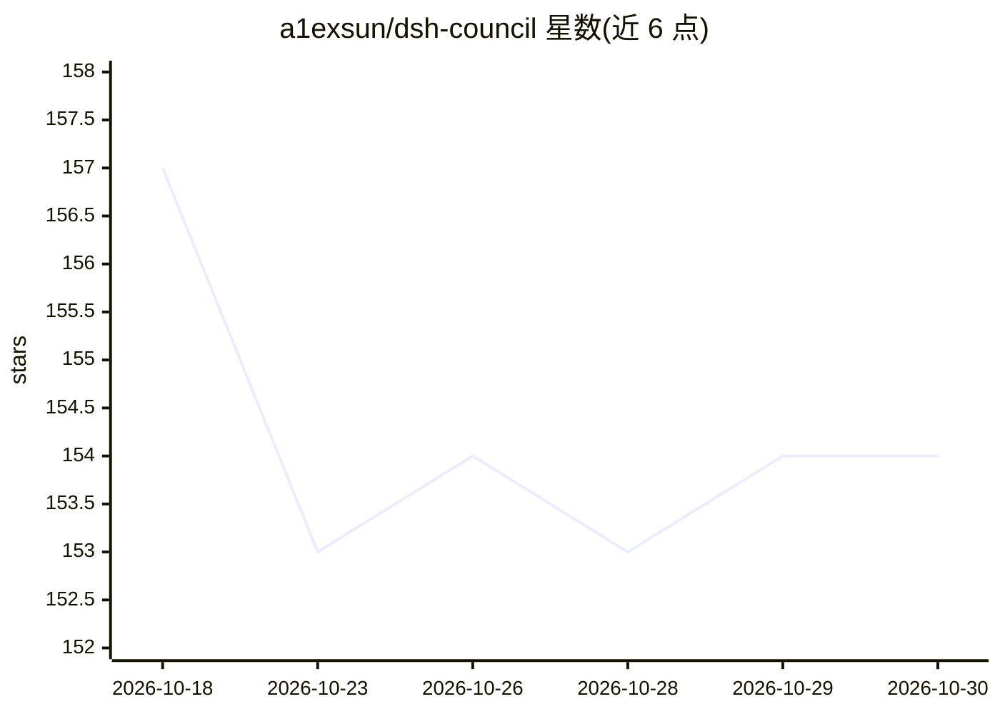

# a1exsun/dsh-council

⭐ 154 · TypeScript · MIT · 推送 2026-09-08 · [GitHub](https://github.com/a1exsun/dsh-council) · 个人维护 · 中文 README

**DeepSeek Harness 的多模型评议会插件：独立作答、匿名互评、合并决策**

运行在 DeepSeek Harness（DSH）内的 TypeScript 插件：2–8 个模型并行独立作答，1–8 个评审对匿名答案比较、找盲点并排名，再由一个仲裁模型综合产出最终建议；结果包含置信说明、共识与分歧、模型身份等信息，原始会话保留在 DSH 子会话中。模型与凭据沿用 DSH 已配置的 provider，各角色可分别选模型，支持中英文。从 npm 安装预构建包，无需编译，要求 Node.js 22.19+/24+ 与至少两个已配置认证的模型。

## 筛选速览

| 维度 | 判定 | 备注 |
|---|---|---|
| AI 角色 | `ai-native` | 本体是模型或模型工具 |
| 许可风险 | `permissive` | MIT |
| 部署形态 | `library` | 以包/库形式分发 |
| 模型依赖 | locked-api |  |
| 硬件要求 | — | 无带数字的原话,不猜 |
| 安装摩擦 | `low` | 无编译、无系统依赖或容器化 |
| 成熟度 | — | 结构信号不足 |

## 能力要点

- Answer/Review/Decide 三阶段多模型审议流程
- 匿名互评与排名，仲裁模型产出最终建议
- 结果可检视：置信说明、共识、分歧、盲点、模型身份与平均排名
- 沿用 DSH 已配置的 provider 与凭据，各角色可分别选模型

## 适用场景

- 在 DSH Web 中用 /council 发起多模型对同一问题的独立作答与互评
- 对比多个模型答案并查看共识与分歧后做决策
- 对关键问题获取带置信说明的综合建议

## 场景标签

`多智能体` · 领域:Agent 开发

## 证据(README 行号)

> L4:  Multi-model deliberation inside DeepSeek Harness.
> L17:  01 · Answer
> L24:  One arbiter weighs the answers and reviews to produce a final recommendation.

## 星数曲线

2026-10-18 157 → 2026-10-30 154（-3）

---
*卡片 v1 · prompt 1.4 · 生成 2026-10-23 · 置信度 high · 依据 README sha `62e8768d3691` · [字段定义](../../DATASET.md)*
