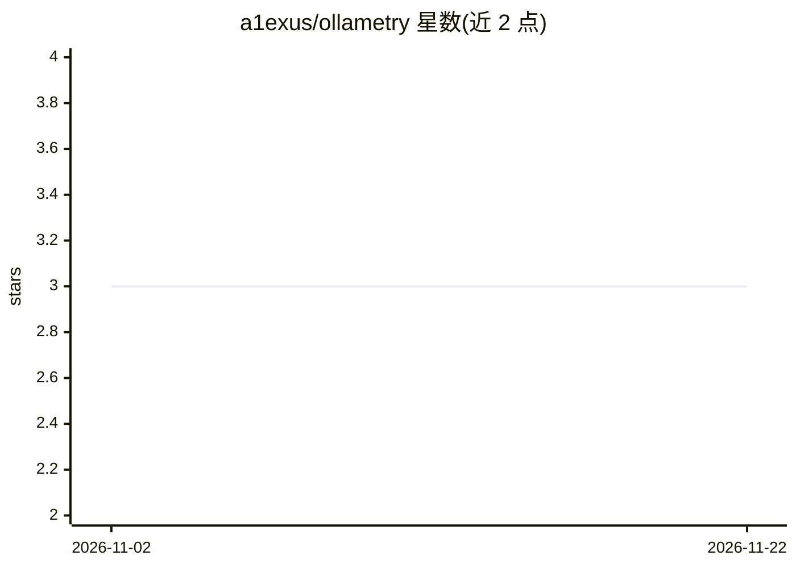

# a1exus/ollametry

⭐ 3 · Go · MIT · 推送 2026-11-16 · [GitHub](https://github.com/a1exus/ollametry) · 个人维护

**为 Ollama 提供 Prometheus/OTel 指标导出的透明代理**

以透明反向代理形式部署在 Ollama 前端，读取 Ollama 响应中已有的使用统计，按模型测量 token 用量、首 token 延迟、解码速度、错误率与内存中模型数，指标遵循 OpenTelemetry GenAI 语义约定。支持两种导出路径：`/metrics` 端点供 Prometheus 抓取，或 OTLP 推送到任意 OpenTelemetry 后端，并附 Grafana 仪表盘。请求与响应（含流式）原样透传，支持 Ollama 原生 API 及 OpenAI/Anthropic 兼容端点，以 Docker Compose 方式运行。

## 筛选速览

| 维度 | 判定 | 备注 |
|---|---|---|
| AI 角色 | `ai-ecosystem` | LLM/agent 周边工具 |
| 许可风险 | `permissive` | MIT |
| 部署形态 | `self-host` | docker 或自建部署 |
| 模型依赖 | local-ok | 支持本地模型 |
| 硬件要求 | — | 无带数字的原话,不猜 |
| 安装摩擦 | `low` | 无编译、无系统依赖或容器化 |
| 成熟度 | — | 结构信号不足 |

## 能力要点

- 透明反向代理，逐字节透传请求与响应（含流式）
- 按模型测量 token、首 token 延迟、解码速度、错误率
- Prometheus `/metrics` 抓取与 OTLP 推送两种导出路径
- 附 Grafana 仪表盘与 OpenAPI 3.1 管理 API

## 适用场景

- 监控本地 Ollama 服务的 token 用量与延迟
- 用 Grafana 看板观察各模型推理性能
- 通过 Prometheus 告警规则监测 LLM 服务错误率

## 场景标签

`LLM 可观测性` · 领域:评测与运维

## 证据(README 行号)

> L10: An **Ollama metrics exporter** for Prometheus and OpenTelemetry. ollametry is a
> L17: - **Prometheus scrape**: `/metrics` on `:11436`, for any Prometheus-compatible
> L19: - **OTLP push**: to `grafana/otel-lgtm`

## 星数曲线

2026-11-02 3 → 2026-11-22 3（+0）

---
*卡片 v1 · prompt 1.4 · 生成 2026-11-22 · 置信度 high · 依据 README sha `d225e54176e5` · [字段定义](../../DATASET.md)*
